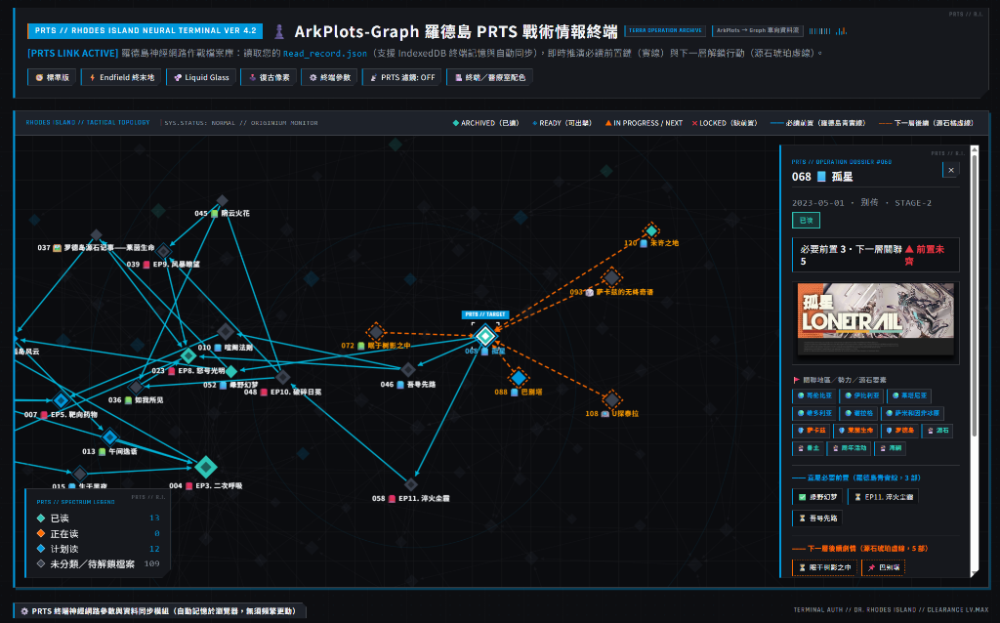

# arkplots-graph `v1`

**明日方舟劇情關聯圖與閱讀進度視覺化工具**（羅德島 PRTS 戰術情報終端版）



> **聲明**：本專案為**個人興趣製作**的純前端延伸視覺化小工具。《明日方舟》相關文本與圖像設定歸上海鷹角網路科技有限公司所有，僅供同好學習與整理閱讀進度交流使用。

---

## 🔗 與 `ArkPlots` 的使用關係

本工具是專為開源專案 **[`ApodidaeDeSwift/ArkPlots`](https://github.com/ApodidaeDeSwift/ArkPlots)** 設計的**外部單向視覺化與拓撲分析介面**：

1. **`ArkPlots`（上游資料與紀錄管理）**：負責維護完整的劇情資料庫 (`Plotline.json`)、活動封面圖庫 (`web/dist/covers/`) 以及您在本地標記的個人閱讀進度 (`Read_record.json`)。
2. **`arkplots-graph`（本專案：全局關聯圖譜）**：
   - **零污染單向讀取**：直接讀取您在 `ArkPlots` 產生的 `Read_record.json`（與 `Plotline.json`），不修改上游任何原始碼或檔案。
   - **雙向拓撲推演**：點擊圖上任一劇情節點（如 `068 孤星`），自動以**羅德島青實線 (`━━`)** 標示所有必讀前置鏈，並以**源石琥珀虛線 (`╌╌`)** 標示依賴該劇情的下一層後續作品。
   - **同級並排自動抓圖**：將本專案資料夾與 `ArkPlots` 放在同一個母目錄下，即可自動載入上游的活動封面圖。

```text
建議並排目錄結構：
├── arknight-tool-ArkPlots/    # 上游 ApodidaeDeSwift/ArkPlots 專案
│   ├── Plotline.json          # 劇情資料庫
│   ├── Read_record.json       # 您在 ArkPlots 標記的閱讀紀錄
│   └── web/dist/covers/       # 活動主題封面圖
│
└── ArkPlots-Graph/            # 本專案 (arkplots-graph)
    ├── index.html             # ♟️ 預設主入口（theme:PRTS 羅德島戰術終端版）
    ├── themes/
    │   ├── ArkPlots-Graph-endfield.html  # 🚧 theme:終末地（開發中預覽版）
    │   ├── ArkPlots-Graph-dev.html       # 🛠️ 開發用簡約版（保持外觀簡單）
    │   └── deprecated/                   # 🗄️ 已封存不再更新之舊版實驗主題 (liquid, retro)
    └── obsidian/              # 📓 選用：匯出為 Obsidian Vault 與 Canvas 圖譜腳本
```

---

## 🚀 快速使用

1. 直接以瀏覽器雙擊開啟 **[`index.html`](index.html)**（無須安裝任何環境或啟動伺服器）。
2. 點擊下方資料來源區的 **「📌 選擇並記住 `Read_record.json`」**（或直接將 `ArkPlots` 目錄下的 `Read_record.json` 拖放進視窗）。
3. 瀏覽器會自動透過 `IndexedDB` 記住檔案位置，後續在 `ArkPlots` 更新閱讀狀態後，可一鍵「🔄 重新同步」或開啟自動監聽。

---

## 🎨 主題版本說明

| 版本 | 檔案路徑 | 狀態與說明 |
| :--- | :--- | :--- |
| **`theme:PRTS`（預設版）** | [`index.html`](index.html) | **主力預設版本**。羅德島 PRTS 戰術終端風格，支援深色終端／淺色醫療檔案室切換。 |
| **`theme:終末地`** | [`themes/ArkPlots-Graph-endfield.html`](themes/ArkPlots-Graph-endfield.html) | **開發中預覽版本 (WIP)**。終末地重工與塔衛二工程藍圖風格。 |
| **`開發簡約版`** | [`themes/ArkPlots-Graph-dev.html`](themes/ArkPlots-Graph-dev.html) | **開發與除錯用版本**。保持最簡單的原生外觀，方便快速驗證資料與拓撲邏輯。 |
| `theme:liquid` / `retro` | [`themes/deprecated/`](themes/deprecated/) | **Deprecated（已棄用封存）**。早期視覺實驗版本，後續不再維護更新。 |
