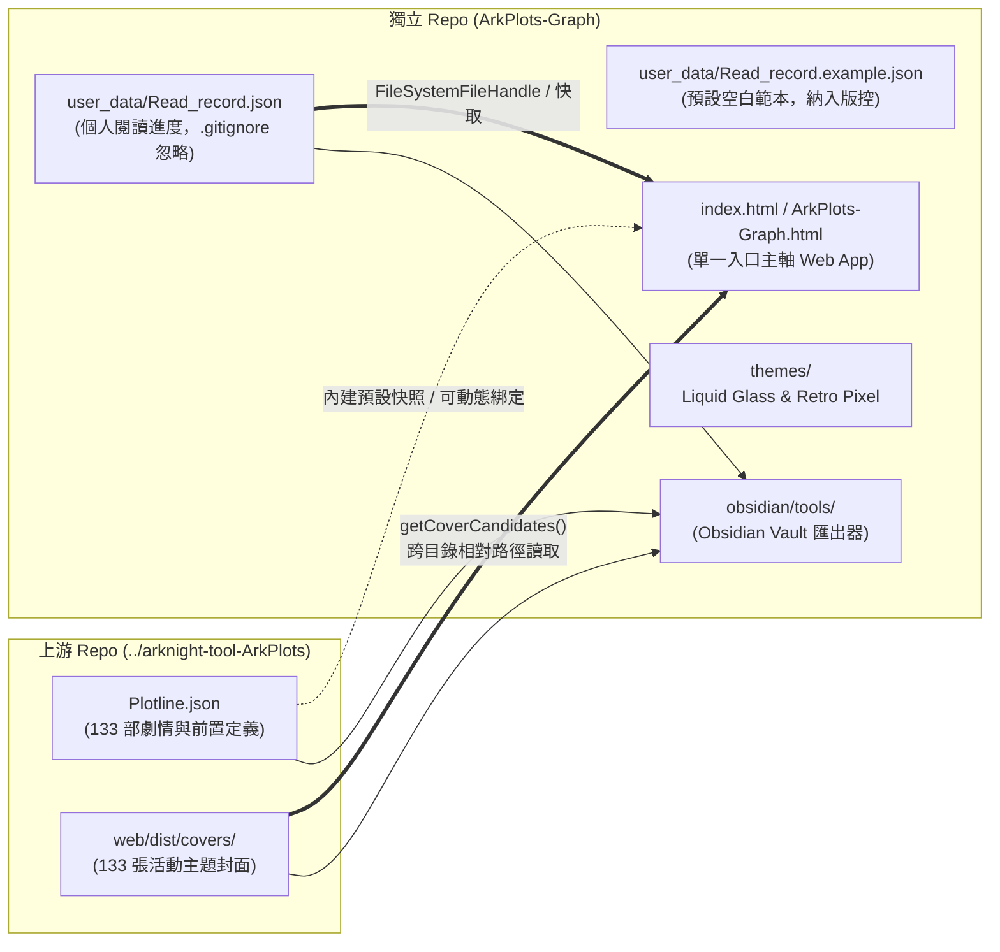

# ADR-001: 同級並排獨立 Repo、零污染隔離與單一入口架構

- **狀態 (Status)**：Accepted（已採納）
- **日期 (Date)**：2026-10-18（2026-10-19 拆分模組化）
- **決策範圍 (Scope)**：Repo 目錄結構（`M:\Github\ArkPlots-Graph`）、單一入口檔（[`/index.html`](file:///m:/Github/ArkPlots-Graph/index.html) / [`/ArkPlots-Graph.html`](file:///m:/Github/ArkPlots-Graph/ArkPlots-Graph.html)）、主題實驗室（[`/themes/`](file:///m:/Github/ArkPlots-Graph/themes)）與用戶資料隔離層（[`/user_data/`](file:///m:/Github/ArkPlots-Graph/user_data/Read_record.json)）
- **關聯文件**：
  - [ADR-002：單向資料流與雙層持久化記憶](file:///m:/Github/ArkPlots-Graph/docs/adr/ADR-002-persistence-and-data-flow.md)
  - [ADR-003：主圖優先版面、雙向拓撲關聯線與封面預覽 UX](file:///m:/Github/ArkPlots-Graph/docs/adr/ADR-003-hero-canvas-and-bidirectional-edges.md)
  - [AI-MAINTENANCE-GUIDE：AI 維護速查手冊（行號、型別與函式表）](file:///m:/Github/ArkPlots-Graph/docs/adr/AI-MAINTENANCE-GUIDE.md)

---

## 1. 背景與問題陳述 (Context)

`ArkPlots-Graph` 是為外部開源專案 [`ApodidaeDeSwift/ArkPlots`](https://github.com/ApodidaeDeSwift/ArkPlots) 打造的互動式劇情拓撲與閱讀進度視覺化伴侶工具。在專案結構與部署形態上，必須滿足以下三項核心約束：

1. **外部 Git Repo 零污染與獨立版控**：
   - 上游 `arknight-tool-ArkPlots` 必須維持 100% 原始 Git 狀態不變（`git status --short` 完全乾淨），方便隨時 `git pull` 同步上游更新；同時 `ArkPlots-Graph` 需要擁有自己獨立的 Git 版本控制與 GitHub 發布能力。
2. **個人閱讀進度隱私隔離**：
   - 使用者的 `Read_record.json` 屬於個人隱私資料，不應直接改寫上游 Repo 根目錄的追蹤檔案，亦不應在公開推送 `ArkPlots-Graph` 時誤傳至遠端。
3. **免伺服器、單一入口即開即用**：
   - 使用者希望能直接雙擊 HTML 檔案（`file://` 協定）或透過 GitHub Pages 靜態網址開啟，不依賴 Python/Node.js 後端伺服器，且在無外網或阻擋 CDN 的環境下版面不可崩潰。

---

## 2. 架構決策 (Decisions)

### 決策 1.1：同級並排（Sibling Repository）目錄配置
- 將 `ArkPlots-Graph` 建立於上游專案同級目錄（`M:\Github\ArkPlots-Graph` 與 `M:\Github\arknight-tool-ArkPlots` 並排）。
- **優點**：
  1. 兩個 Git Repo 完全獨立，互不干擾。
  2. 透過相對路徑 `../arknight-tool-ArkPlots/web/dist/covers/{id}.(png|jpg)`，本專案的 `index.html`（以及 `themes/` 子目錄下的 `../../arknight-tool-ArkPlots/web/dist/covers/`）可直接讀取上游的 133 張封面圖，無須在兩個 Repo 間重複複製數十 MB 的圖片資產。
  3. Python 匯出器 [`arkplots_core.py`](file:///m:/Github/ArkPlots-Graph/obsidian/tools/arkplots_core.py#L20-L27) 透過 `_resolve_upstream_root()` 自動偵測同級的 `../arknight-tool-ArkPlots/Plotline.json`。

### 決策 1.2：單一入口 HTML + 原生 CSS 保底規則
- 主軸應用程式封裝於單一檔案 [`index.html`](file:///m:/Github/ArkPlots-Graph/index.html)（並提供同內容別名 [`ArkPlots-Graph.html`](file:///m:/Github/ArkPlots-Graph/ArkPlots-Graph.html)）。
- 檔案內嵌：
  - **原生 CSS Fallback 規則**（[`L34–L118`](file:///m:/Github/ArkPlots-Graph/index.html#L34-L118)）：即使 Tailwind CDN 被離線環境阻擋，Flex/Grid 版面、懸浮面板 (`.floating-panel`) 與四欄設定區 (`#settingsSection`) 依然能正常排版。
  - **133 部劇情預清理快照 (`DEFAULT_DATA`)**（[`L252–L386`](file:///m:/Github/ArkPlots-Graph/index.html#L252-L386)）：讓使用者首次雙擊打開時無須先選檔即可立即互動。

### 決策 1.3：`user_data/` 個人閱讀紀錄隔離與 `.gitignore` 防護
- 個人閱讀進度存放於 [`user_data/Read_record.json`](file:///m:/Github/ArkPlots-Graph/user_data/Read_record.json)，並由 [`.gitignore`](file:///m:/Github/ArkPlots-Graph/.gitignore) 明確排除。
- 版本庫僅追蹤 [`user_data/Read_record.example.json`](file:///m:/Github/ArkPlots-Graph/user_data/Read_record.example.json) 作為結構範本。

### 決策 1.4：多主題實驗室收納於 `themes/`
- 為保持根目錄入口乾淨，將兩種特殊風格版本收納於 [`themes/`](file:///m:/Github/ArkPlots-Graph/themes) 子資料夾：
  - [`themes/ArkPlots-Graph-liquid-glass.html`](file:///m:/Github/ArkPlots-Graph/themes/ArkPlots-Graph-liquid-glass.html)（Apple 風格 SVG 光學折射濾鏡與 3D 液態玻璃球節點）
  - [`themes/ArkPlots-Graph-retro-pixel.html`](file:///m:/Github/ArkPlots-Graph/themes/ArkPlots-Graph-retro-pixel.html)（PICO-8 復古像素、CRT 掃描線與八角像素節點）

---

## 3. 後果與影響 (Consequences)

- **正面效益**：
  - 上游 `arknight-tool-ArkPlots` 維持 0 修改，隨時可無衝突更新。
  - `ArkPlots-Graph` 具備標準 GitHub Pages 入口 (`index.html`)，推送至 GitHub 後即可直接提供線上預覽。
- **維護注意事項**：
  - 若未來修改主軸 `index.html` 的核心資料流或互動功能，應同步更新 `ArkPlots-Graph.html`（以及視需求同步至 `themes/` 下的兩個主題檔）。
