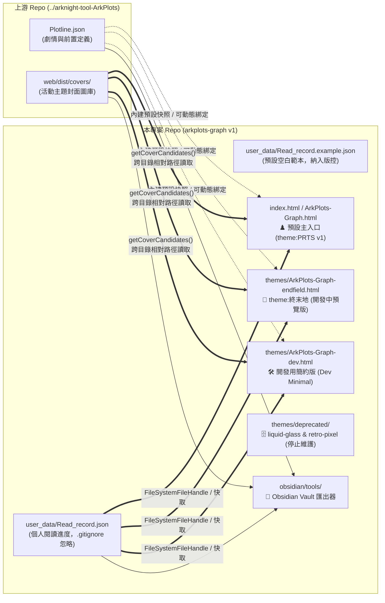

# ADR-001: 同級並排獨立 Repo、零污染隔離與 `v1` 多主題版本分層架構

- **狀態 (Status)**：Accepted（`v1` 已採納並發布）
- **日期 (Date)**：2026-10-18（2026-10-19 更新至 `v1` PRTS 預設版架構）
- **決策範圍 (Scope)**：Repo 目錄結構（`M:\Github\ArkPlots-Graph`）、預設單一入口（[`/index.html`](file:///m:/Github/ArkPlots-Graph/index.html) / [`/ArkPlots-Graph.html`](file:///m:/Github/ArkPlots-Graph/ArkPlots-Graph.html)）、主題分層目錄（[`/themes/`](file:///m:/Github/ArkPlots-Graph/themes) 與 [`/themes/deprecated/`](file:///m:/Github/ArkPlots-Graph/themes/deprecated)）及用戶資料隔離層（[`/user_data/`](file:///m:/Github/ArkPlots-Graph/user_data/Read_record.example.json)）
- **關聯文件**：
  - [ADR-002：單向資料流與雙層持久化記憶](file:///m:/Github/ArkPlots-Graph/docs/adr/ADR-002-persistence-and-data-flow.md)
  - [ADR-003：主圖優先版面、2x 物理間距、雙向拓撲關聯線與封面預覽 UX](file:///m:/Github/ArkPlots-Graph/docs/adr/ADR-003-hero-canvas-and-bidirectional-edges.md)
  - [AI-MAINTENANCE-GUIDE：AI 維護速查手冊（行號、型別與函式表）](file:///m:/Github/ArkPlots-Graph/docs/adr/AI-MAINTENANCE-GUIDE.md)

---

## 1. 背景與問題陳述 (Context)

`arkplots-graph` 是因個人興趣為外部開源專案 [`ApodidaeDeSwift/ArkPlots`](https://github.com/ApodidaeDeSwift/ArkPlots) 打造的互動式劇情拓撲與閱讀進度視覺化工具。在專案結構、主題演進與部署形態上，必須滿足以下四項核心約束：

1. **外部 Git Repo 零污染與獨立版控**：
   - 上游 `arknight-tool-ArkPlots` 必須維持 100% 原始 Git 狀態不變（`git status --short` 完全乾淨），方便隨時 `git pull` 同步上游更新；同時 `arkplots-graph` 擁有獨立的 Git 版本控制與 GitHub Release (`v1`)。
2. **個人閱讀進度隱私隔離**：
   - 使用者的 `Read_record.json` 屬於個人隱私資料，不應直接改寫上游 Repo 根目錄的追蹤檔案，亦不應在公開推送 `arkplots-graph` 時誤傳至遠端。
3. **免伺服器、單一入口即開即用**：
   - 使用者直接雙擊 HTML 檔案（`file://` 協定）或透過 GitHub Pages 靜態網址即可開啟，不依賴 Python/Node.js 後端伺服器，且在無外網環境下具備原生 CSS Fallback 保底。
4. **主題收斂與開發維護分層 (`v1`)**：
   - 經過多款 UI 風格探索後，決定在 `v1` 將最具《明日方舟》代表性的 **羅德島 PRTS 戰術情報終端 (`theme:PRTS`)** 定為預設主入口，將原本的極簡標準版轉為**開發測試用簡約版 (`Dev Minimal`)**，將 **終末地 (`theme:終末地`)** 列為**開發中預覽版 (`WIP Preview`)**，並將早期實驗主題（`liquid`, `retro`）移入 `deprecated/` 封存不再更新。

---

## 2. 架構決策 (Decisions)

### 決策 1.1：同級並排（Sibling Repository）目錄配置
- 將 `ArkPlots-Graph` 建立於上游專案同級目錄（`M:\Github\ArkPlots-Graph` 與 `M:\Github\arknight-tool-ArkPlots` 並排）。
- **優點**：
  1. 兩個 Git Repo 完全獨立，互不干擾。
  2. 透過 [`getCoverCandidates(id)`](file:///m:/Github/ArkPlots-Graph/index.html#L1294-L1318) 的多層相對路徑備援（根目錄優先讀取 `../arknight-tool-ArkPlots/web/dist/covers/`，`themes/` 子目錄優先讀取 `../../arknight-tool-ArkPlots/web/dist/covers/`），可直接載入上游封面圖，無須在兩個 Repo 間重複複製圖片資產。
  3. Python 匯出器 [`arkplots_core.py`](file:///m:/Github/ArkPlots-Graph/obsidian/tools/arkplots_core.py#L20-L27) 透過 `_resolve_upstream_root()` 自動偵測同級的 `../arknight-tool-ArkPlots/Plotline.json`。

### 決策 1.2：`v1` 主題版本分層與生命週期管理
為平衡「終端玩家的沉浸式體驗」、「新主題實驗」與「開發除錯效率」，`v1` 將前端入口分為四個明確層級：

| 層級與定位 | 檔案路徑 | 維護狀態與用途 |
| :--- | :--- | :--- |
| **1. 預設主力版 (`theme:PRTS`)** | [`index.html`](file:///m:/Github/ArkPlots-Graph/index.html)、[`ArkPlots-Graph.html`](file:///m:/Github/ArkPlots-Graph/ArkPlots-Graph.html)、[`themes/ArkPlots-Graph-arknights.html`](file:///m:/Github/ArkPlots-Graph/themes/ArkPlots-Graph-arknights.html) | **Active (Default `v1`)**。羅德島 PRTS 戰術終端風（參考 `MooncellWiki/prts-design` 與 `YunYouJun/ak-ui`），具備菱形戰術節點、`[ + ]` 鎖定準星、理智同步率進度條與深色終端／淺色醫療室雙模式。 |
| **2. 開發中預覽版 (`theme:終末地`)** | [`themes/ArkPlots-Graph-endfield.html`](file:///m:/Github/ArkPlots-Graph/themes/ArkPlots-Graph-endfield.html) | **WIP Preview（開發預覽）**。終末地重工與塔衛二工程藍圖風（參考 `RoyZ-iwnl/ReEnd-Components`），支援深色軌道探測 HUD 與淺色米白工程圖紙＋訊號黃 (`#ffe600`) 雙模式。 |
| **3. 開發用簡約版 (`Dev Minimal`)** | [`themes/ArkPlots-Graph-dev.html`](file:///m:/Github/ArkPlots-Graph/themes/ArkPlots-Graph-dev.html) | **Active (Dev Baseline)**。由原先的 `標準版` 轉型而成，保持最簡單的原生 UI 外觀與最少裝飾，供快速驗證資料流與拓撲演算法。 |
| **4. 已棄用封存版 (`Deprecated`)** | [`themes/deprecated/ArkPlots-Graph-liquid-glass.html`](file:///m:/Github/ArkPlots-Graph/themes/deprecated/ArkPlots-Graph-liquid-glass.html)、[`themes/deprecated/ArkPlots-Graph-retro-pixel.html`](file:///m:/Github/ArkPlots-Graph/themes/deprecated/ArkPlots-Graph-retro-pixel.html) | **Deprecated（停止更新）**。早期視覺實驗產物，已移出主導覽列並標記封存，後續不再同步新功能。 |

### 決策 1.3：`user_data/` 個人閱讀紀錄隔離與 `.gitignore` 防護
- 個人閱讀進度存放於 `user_data/Read_record.json`，並由 [`.gitignore`](file:///m:/Github/ArkPlots-Graph/.gitignore) 明確排除。
- 版本庫僅追蹤 [`user_data/Read_record.example.json`](file:///m:/Github/ArkPlots-Graph/user_data/Read_record.example.json) 作為結構範本。

---

## 3. 後果與影響 (Consequences)

- **正面效益**：
  - 使用者雙擊 `index.html` 或造訪 GitHub Pages 時，第一眼即進入完成度最高的 **PRTS 戰術情報終端版 (`v1`)**。
  - 開發者在需要排查單純的 DOM/Canvas 邏輯時，仍可切換至輕量的 `themes/ArkPlots-Graph-dev.html`，不被複雜的 CSS 濾鏡或切角干擾。
  - 將 `liquid` 與 `retro` 移至 `themes/deprecated/` 後，大幅減輕後續每次修改功能時需同步維護多份 HTML 的負擔。
