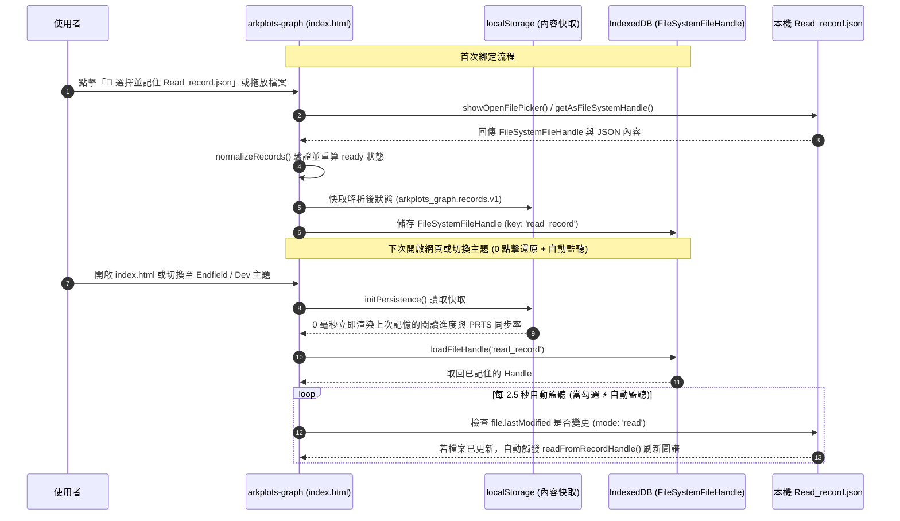

# ADR-002: 單向資料流、雙層持久化記憶 (`IndexedDB` + `localStorage`) 與雙向寫回備案

- **狀態 (Status)**：Accepted（`v1` 已採納）
- **日期 (Date)**：2026-10-18（2026-10-19 更新至 `v1` PRTS 預設版行號）
- **決策範圍 (Scope)**：`index.html` 儲存層（[`L739–L830`](file:///m:/Github/ArkPlots-Graph/index.html#L739-L830)）、資料清理層（[`L832–L948`](file:///m:/Github/ArkPlots-Graph/index.html#L832-L948)）與檔案綁定／自動監聽層（[`L1751–L2099`](file:///m:/Github/ArkPlots-Graph/index.html#L1751-L2099)）
- **關聯文件**：
  - [ADR-001：同級並排獨立 Repo、零污染隔離與 `v1` 多主題版本分層架構](file:///m:/Github/ArkPlots-Graph/docs/adr/ADR-001-arkplots-graph-architecture.md)
  - [ADR-003：主圖優先版面、2x 物理間距、雙向拓撲關聯線與封面預覽 UX](file:///m:/Github/ArkPlots-Graph/docs/adr/ADR-003-hero-canvas-and-bidirectional-edges.md)
  - [AI-MAINTENANCE-GUIDE：AI 維護速查手冊（行號、型別與函式表）](file:///m:/Github/ArkPlots-Graph/docs/adr/AI-MAINTENANCE-GUIDE.md)

---

## 1. 背景與問題陳述 (Context)

1. **避免重複選檔的痛點**：
   - 傳統純前端網頁每次重新整理 (`F5`) 或重開瀏覽器時，透過 `<input type="file">` 載入的檔案都會遺失，迫使使用者每次開啟都要重新尋找並選取 `Read_record.json`。
2. **單向唯讀安全性与跨主題共享記憶**：
   - 使用者目前的閱讀狀態管理以 `ArkPlots` 為主，希望資料流保持 **`ArkPlots → arkplots-graph` 單向同步**，且在 `PRTS 預設版`、`Endfield 開發預覽版` 與 `開發簡約版` 之間切換時，能自動共享同一份已綁定的 `Read_record.json` Handle 與快取。
3. **上游 `Plotline.json` 異常資料防護**：
   - 上游 `Plotline.json` 的 `necessary_plot` 欄位存在少數歷史異常（如 #44、#85 誤將影片 `{name, url}` 放進前置陣列、#55 自我依賴、#42 重複前置），前端必須具備獨立清理能力。

---

## 2. 架構決策 (Decisions)

### 2.1 雙層持久化記憶機制（`IndexedDB` Handle + `localStorage` 快取）



1. **第一層（`IndexedDB` 記住真實資料夾與檔案控制代碼）**：
   - **資料夾一次綁定 (`showDirectoryPicker`)**：點擊「📁 綁定 `ArkPlots` 資料夾 (含封面)」或拖放 `ArkPlots` 資料夾時，取得 `FileSystemDirectoryHandle` 存入 `IndexedDB` (`key: 'arkplots_dir'`)，由 [`readFromArkPlotsDirHandle()`](file:///m:/Github/ArkPlots-Graph/index.html#L1844-L1901) 自動定位該目錄內的 `Read_record.json`、`Plotline.json`，並透過 [`scanCoversFromDirHandle()`](file:///m:/Github/ArkPlots-Graph/index.html#L1805-L1842) 自動掃描 `web/dist/covers/`、`_internal/web/dist/covers/`（PyInstaller 安裝版）等路徑建立 `Blob URL` 封面快取 (`customCoverUrls`)，徹底解除兩個資料夾必須並排擺放的位置限制。
   - **單一檔案綁定 (`showOpenFilePicker`)**：亦支援透過「📌 單選紀錄」取得單一 `FileSystemFileHandle` 存入 `IndexedDB` (`ArkPlotsGraphDB` / `file_handles`)。
   - 支援「🔄 重新同步」一鍵重讀，以及勾選「⚡ 自動監聽存檔更新」時每 2.5 秒（與視窗 `focus` 時）比對 `file.lastModified` 自動刷新。
2. **第二層（`localStorage` 0 毫秒快取還原）**：
   - 每次成功讀取 `Read_record.json`、`Plotline.json` 或切換 UI 設定時，同步寫入 `localStorage`。
   - 資料快取鍵（`arkplots_graph.records.v1`、`arkplots_graph.plotline.v1`）在所有主題版本間共享；而各主題專屬的視覺設定（如預設色盤 `prts_tactical` vs `endfield_aic`、濾鏡開關 `overlay`）則使用獨立命名空間（如 `arkplots_graph.ui_state.arknights.v1`、`arkplots_graph.ui_state.endfield.v1`）互不覆蓋。

### 2.2 100% 前端化資料正規化與分流防護
- [`normalizePlotline(rawInput)`](file:///m:/Github/ArkPlots-Graph/index.html#L833-L887)：在瀏覽器端完整重現與 Python `arkplots_core.py` 相同的清理邏輯，自動過濾無效 ID、自我參照、重複前置與誤植的影片連結。
- [`normalizeRecords(rawObj)`](file:///m:/Github/ArkPlots-Graph/index.html#L889-L909) 與自動分流：若使用者在選擇 `Read_record.json` 時誤選了 `Plotline.json`（含 `data` 陣列），系統會自動識別並分流至 `applyPlotlineData()`，不會覆蓋或污染閱讀紀錄。

---

## 3. 儲存結構規範 (Storage Schema)

| 儲存媒介 | 名稱 / Key | 內容格式 | 負責讀寫函式 | 用途說明 |
| --- | --- | --- | --- | --- |
| `IndexedDB` | `ArkPlotsGraphDB` / `file_handles` (`arkplots_dir`) | `FileSystemDirectoryHandle` | `saveFileHandle()` / `readFromArkPlotsDirHandle()` | 記住使用者選取的 `ArkPlots` 主資料夾，自動定位 `Read_record.json`、`Plotline.json` 與 `covers/` 封面圖 |
| `IndexedDB` | `ArkPlotsGraphDB` / `file_handles` (`read_record`) | `FileSystemFileHandle` | `saveFileHandle()` / `loadFileHandle()` | 記住使用者選取的 `Read_record.json` 檔案控制代碼，跨主題共享 |
| `IndexedDB` | `ArkPlotsGraphDB` / `file_handles` (`plotline`) | `FileSystemFileHandle` | `saveFileHandle()` / `loadFileHandle()` | 記住使用者自訂載入的 `Plotline.json` 檔案控制代碼 |
| `localStorage` | `arkplots_graph.records.v1` | `Record<string, ReadStatus>` | `applyRecordsData()` / `initPersistence()` | 快取最新解析的劇情閱讀狀態（跨主題共享） |
| `localStorage` | `arkplots_graph.records_meta.v1` | `{ fileName, lastModified, syncedAt, sourceType }` | `applyRecordsData()` / `updateSourcePanel()` | 紀錄來源檔名、最後修改時間與綁定模式（`handle` / `cache` / `file`） |
| `localStorage` | `arkplots_graph.plotline.v1` | `NormalizedPlot[]` | `applyPlotlineData()` / `initPersistence()` | 快取自訂載入並清理後的 `Plotline.json` 劇情陣列 |
| `localStorage` | `arkplots_graph.ui_state.arknights.v1` | `{ preset, emo, pos, arrows, hidePeriph, fade, autoWatch, light, overlay }` | `persistUIState()` | 記住 `PRTS 預設版` 的配色主軸、Emoji 方案、PRTS 濾鏡與深淺模式 |
| `localStorage` | `arkplots_graph.ui_state.endfield.v1` | `{ preset, emo, pos, arrows, hidePeriph, fade, autoWatch, light, overlay }` | `persistUIState()` | 記住 `Endfield 預覽版` 的配色主軸、工程藍圖濾鏡與深淺模式 |
| `localStorage` | `arkplots_graph.ui_state.v1` | `{ preset, emo, pos, arrows, hidePeriph, fade, autoWatch, light }` | `persistUIState()` | 記住 `Dev 開發簡約版` 的基礎 UI 偏好 |

---

## 4. 備案設計：雙向編輯與直接寫回 (Backup Option: Bidirectional Sync)

若未來希望直接在 `arkplots-graph` 點擊節點修改閱讀狀態，並同步寫回本機 `Read_record.json`，可在不更動整體架構的前提下直接擴充：

1. **UI 觸發**：於右側懸浮資訊窗 (`#selCard`) 加入四顆狀態切換按鈕（`未读` / `计划读` / `正在读` / `已读`）。
2. **原檔直接寫回（透過既有 `boundRecordHandle` 請求 `readwrite` 權限）**：
   ```javascript
   async function saveRecordsToBoundFile(updatedRecords) {
     if (boundRecordHandle && typeof boundRecordHandle.createWritable === 'function') {
       const perm = await boundRecordHandle.requestPermission({ mode: 'readwrite' });
       if (perm === 'granted') {
         const writable = await boundRecordHandle.createWritable();
         await writable.write(JSON.stringify(updatedRecords, null, 2) + '\n');
         await writable.close();
         return true;
       }
     }
     return false;
   }
   ```
3. **跨瀏覽器保底匯出**：若環境不支援 `createWritable()`，提供「💾 匯出 `Read_record.json`」按鈕觸發 Blob 下載，同時更新 `localStorage`。
