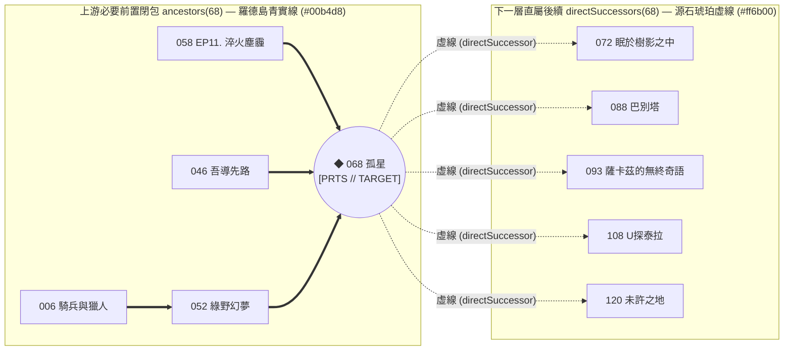

# ADR-003: 主圖優先版面、2x 物理間距調校、雙向拓撲關聯線与 PRTS 視覺 UX

- **狀態 (Status)**：Accepted（`v1` 已採納）
- **日期 (Date)**：2026-10-19
- **決策範圍 (Scope)**：UI 佈局（[`L530–L726`](file:///m:/Github/ArkPlots-Graph/index.html#L530-L726)）、力導向物理間距調校（[`L1224–L1272`](file:///m:/Github/ArkPlots-Graph/index.html#L1224-L1272)）、雙向關聯演算法（[`L1274–L1291`](file:///m:/Github/ArkPlots-Graph/index.html#L1274-L1291)）、右側懸浮窗 `#selCard`（[`L1330–L1437`](file:///m:/Github/ArkPlots-Graph/index.html#L1330-L1437)）與 PRTS 戰術雷達渲染器 `draw()`（[`L1440–L1668`](file:///m:/Github/ArkPlots-Graph/index.html#L1440-L1668)）
- **關聯文件**：
  - [ADR-001：同級並排獨立 Repo、零污染隔離與 `v1` 多主題版本分層架構](file:///m:/Github/ArkPlots-Graph/docs/adr/ADR-001-arkplots-graph-architecture.md)
  - [ADR-002：單向資料流與雙層持久化記憶](file:///m:/Github/ArkPlots-Graph/docs/adr/ADR-002-persistence-and-data-flow.md)
  - [AI-MAINTENANCE-GUIDE：AI 維護速查手冊（行號、型別與函式表）](file:///m:/Github/ArkPlots-Graph/docs/adr/AI-MAINTENANCE-GUIDE.md)

---

## 1. 背景與問題陳述 (Context)

在初期原型與迭代實測中，我們針對以下五個核心體驗問題進行了架構與參數決策：

1. **左側設定欄佔用主畫面空間**：
   - 配色主軸、Emoji 規則、資料來源等設定項目在初次設定好後便不常更動，若常駐於左側欄會壓縮關聯圖畫布的水平可視範圍。
2. **節點詳情面板遮蔽中央節點樹**：
   - 若將選取節點的長篇前置鏈直接展開於畫布左上角，容易遮擋住中央偏左的早期核心劇情節點。
3. **只看得到「過去（前置）」，看不到「未來（後續延伸）」**：
   - 點擊某部核心劇情（例如 `068 孤星`）時，使用者除了想知道「讀這部之前要先補誰」，也常想一併看出「讀完這部之後會解鎖哪些下一層劇情（如 `120 未许之地`、`088 巴别塔`）」，且兩者在視覺線條上必須一眼就能區分。
4. **節點密度過高、文字標籤互相重疊**：
   - 原始力導向參數（彈簧長度 `70`、斥力 `2200/d2`、向心力 `0.004/0.006`）會將 134 個節點向中心過度擠壓，導致平衡態節點間距僅約 `35–45px`，在放大檢視時節點與標題文字過於擁擠。
5. **主題沉浸感與封面記憶點**：
   - 結合《明日方舟》羅德島 PRTS 戰術終端視覺語言（菱形算子節點、`[ + ]` 鎖定準星、45° 機甲切角面板）與活動宣傳封面圖預覽，大幅提升工具的辨識度與操作直覺。

---

## 2. 架構決策 (Decisions)

### 2.1 主圖優先版面（Full-Width Hero Graph + Bottom 4-Column Settings）
- **頂部滿版畫布 (`#graph`)**：將關聯圖畫布移至頁面最上方，佔據 100% 容器寬度與 `clamp(560px, 72vh, 740px)` 高度，提供最開闊的節點探索空間。
- **下方四欄設定網格 (`#settingsSection`)**：將「⓪ PRTS 神經網路存檔與 ③ 雷達過濾」、「① 戰術光譜塗裝」、「② 檔案識別標記與 📡 戰況摘要」、「🏷️ Obsidian 檔名預覽與 ⚙️ `graph.json` 匯出」收納於畫布下方的響應式 4 欄網格。

### 2.2 力導向圖 2 倍節點間距物理調校（2x Node Spacing Calibration）
為使所有節點在物理平衡態下的間距放大約 **2 倍**（由 `~40px` 提升至 `~85–95px`），於 [`rebuildNodesSimulation()`](file:///m:/Github/ArkPlots-Graph/index.html#L1224-L1240) 與 [`tick()`](file:///m:/Github/ArkPlots-Graph/index.html#L1246-L1260) 採納以下經過尺度不變性（Scale Invariance）推導的物理參數：

| 物理參數項目 | 調整前（舊版過密） | 調整後（`v1` 放大 2 倍間距） | 物理意義說明 |
| :--- | :--- | :--- | :--- |
| **初始時間軸跨度 (`x × y`)** | `1400 × 700`（抖動 `60`） | **`2400 × 1300`**（抖動 `110`） | 按上線日期由左至右展開的初始世界座標範圍放大近 2 倍 |
| **連邊彈簧靜止長度 (`L0`)** | `70` (`(d - 70) * 0.012`) | **`145`** (`(d - 145) * 0.012`) | 直接拉開有前後置關聯之相鄰節點的目標距離（$2.07\times$） |
| **節點間庫侖斥力 (`f`)** | `2200 / d2`（截斷 `d2 > 250000`） | **`9200 / d2`**（截斷 `d2 > 1000000`） | 因斥力與距離平方成反比（$f \propto 1/d^2$），在 $2\times$ 距離下需 $>4\times$ 斥力常數並將作用半徑由 $500\text{px}$ 擴至 $1000\text{px}$ |
| **中心向心力 (`gx, gy`)** | `0.004, 0.006` | **`0.0018, 0.0028`** | 減半向內收縮的向心力，防止外圍節點在 220 次迭代後被擠回中心 |

### 2.3 雙向拓撲視覺語意：羅德島青實線必要前置 (`━━`) ＋ 源石琥珀虛線下一層 (`╌╌`)

- **上游必要前置閉包（[`ancestors(id)`](file:///m:/Github/ArkPlots-Graph/index.html#L1274-L1283)，實線 `━━`）**：
  - 以 BFS 遞迴回溯所有直接與間接必要前置，於 Canvas 上以**羅德島醫療青實線 (`#00b4d8` / 淺色 `#0077b6`)** 繪製，代表「必須先完成的硬性基礎」。
- **下一層後續劇情（[`directSuccessors(id)`](file:///m:/Github/ArkPlots-Graph/index.html#L1285-L1291)，虛線 `╌╌`）**：
  - 掃描 `DATA` 中所有將當前選取節點列為直屬必要前置 (`d.nec.includes(id)`) 的 1-hop 下游劇情，於 Canvas 上以**源石琥珀橙虛線 (`#ff6b00`, `setLineDash([7 / Math.sqrt(T.k), 4.5 / Math.sqrt(T.k)])`)** 與**菱形虛線外框**高亮，代表「讀完本篇後直接延伸的下一層行動」。
- **PRTS 菱形算子與鎖定準星（[`drawPrtsNode()`](file:///m:/Github/ArkPlots-Graph/index.html#L1440-L1528)）**：
  - 節點以菱形（Rhombus/Diamond）繪製；主線與高被引用樞紐（`inDeg >= 4`）具有雙層內核；選取節點時繪製四角 `[ + ]` 戰術鎖定框與上方 `PRTS // TARGET` 懸浮銘牌。

### 2.4 右側固定寬度懸浮檔案卡 (`#selCard`) 與 Hover 防閃爍封面預覽 (`#tip`)
- 點擊節點時，右侧 `#selCard`（[`updateSelectedPanel()`](file:///m:/Github/ArkPlots-Graph/index.html#L1330-L1437)）顯示活動封面圖 (`#selCoverImg`)、地區／勢力／源石要素標籤，以及可點擊跳轉的 `.jump-pill[data-jump-id]`。
- 外層容器 `.prts-viewport-shell` 刻意不套用 `clip-path`，確保內部 `#selCard` 的捲軸與 `#tip` 懸浮卡片不會被機甲切角裁切。
- 滑鼠移過節點時，僅當 `tipKey`（`id|emo|pos|status`）改變時才更新 `#tip.innerHTML`，避免圖片重複請求與閃爍。
