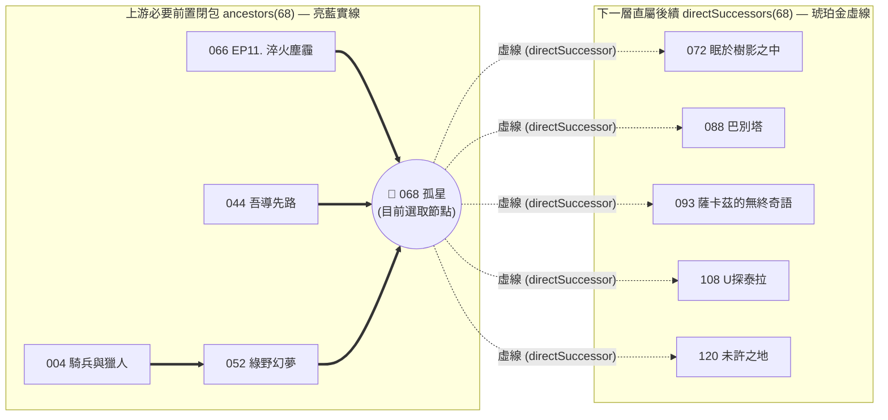

# ADR-003: 主圖優先版面、雙向拓撲關聯線（實線前置＋虛線下一層）與封面預覽 UX

- **狀態 (Status)**：Accepted（已採納）
- **日期 (Date)**：2026-10-19
- **決策範圍 (Scope)**：UI 佈局（[`L139–L251`](file:///m:/Github/ArkPlots-Graph/index.html#L139-L251)）、雙向關聯演算法（[`L873–L890`](file:///m:/Github/ArkPlots-Graph/index.html#L873-L890)）、右側懸浮窗 `#selCard`（[`L920–L1026`](file:///m:/Github/ArkPlots-Graph/index.html#L920-L1026)）、Canvas 渲染器 `draw()`（[`L1028–L1090`](file:///m:/Github/ArkPlots-Graph/index.html#L1028-L1090)）與 Hover 提示卡 `#tip`（[`L1110–L1142`](file:///m:/Github/ArkPlots-Graph/index.html#L1110-L1142)）
- **關聯文件**：
  - [ADR-001：同級並排獨立 Repo、零污染隔離與單一入口架構](file:///m:/Github/ArkPlots-Graph/docs/adr/ADR-001-arkplots-graph-architecture.md)
  - [ADR-002：單向資料流與雙層持久化記憶](file:///m:/Github/ArkPlots-Graph/docs/adr/ADR-002-persistence-and-data-flow.md)
  - [AI-MAINTENANCE-GUIDE：AI 維護速查手冊（行號、型別與函式表）](file:///m:/Github/ArkPlots-Graph/docs/adr/AI-MAINTENANCE-GUIDE.md)

---

## 1. 背景與問題陳述 (Context)

在初期的雙欄式原型中，實測發現以下四個影響閱讀體驗的 UI/UX 問題：

1. **左側設定欄佔用主畫面空間**：
   - 配色主軸、Emoji 規則、資料來源等設定項目在初次設定好後便不常更動，若常駐於左側欄會壓縮關聯圖畫布的水平可視範圍。
2. **節點詳情面板遮蔽中央節點樹**：
   - 若將選取節點的長篇前置鏈直接展開於畫布左上角，容易遮擋住中央偏左的早期核心劇情節點。
3. **只看得到「過去（前置）」，看不到「未來（後續延伸）」**：
   - 點擊某部核心劇情（例如 `068 孤星`）時，使用者除了想知道「讀這部之前要先補誰」，也常想一併看出「讀完這部之後會解鎖或關聯到哪些下一層劇情（如 `120 未许之地`、`088 巴别塔`）」，且兩者在視覺線條上必須一眼就能區分。
4. **缺乏直覺的視覺記憶點（活動封面圖）**：
   - 玩家對明日方舟活動的印象高度綁定活動宣傳封面（Cover），僅顯示文字標題不夠直觀。

---

## 2. 架構決策 (Decisions)

### 2.1 主圖優先版面（Full-Width Hero Graph + Bottom 4-Column Settings）
- **頂部滿版畫布 (`#graph`)**：將關聯圖畫布移至頁面最上方，佔據 100% 視窗寬度與 `68vh`（最小 `560px`）高度，提供最開闊的節點探索空間。
- **下方四欄設定網格 (`#settingsSection`)**：將「⓪ 資料來源與 ① 色彩主軸」、「② Emoji 與顯示微調」、「💡 配色洞察與檔名預覽」、「📋 Obsidian `graph.json` 匯出」收納於畫布下方的響應式 4 欄網格，並於 Header 提供「⚙️ 下方設定」快速捲動錨點。

### 2.2 雙向拓撲視覺語意：實線必要前置 (`━━`) ＋ 虛線下一層後續 (`╌╌`)

- **上游必要前置閉包（[`ancestors(id)`](file:///m:/Github/ArkPlots-Graph/index.html#L873-L882)，實線 `━━`）**：
  - 以 BFS 遞迴回溯所有直接與間接必要前置，於 Canvas 上以**亮藍實線 (`rgba(147,197,253,0.88)`)** 繪製，代表「必須先完成的硬性基礎」。
- **下一層後續劇情（[`directSuccessors(id)`](file:///m:/Github/ArkPlots-Graph/index.html#L884-L890)，虛線 `╌╌`）**：
  - 掃描 `DATA` 中所有將當前選取節點列為直屬必要前置 (`d.nec.includes(id)`) 的 1-hop 下游劇情，於 Canvas 上以**琥珀金虛線 (`ctx.setLineDash([7 / Math.sqrt(T.k), 4.5 / Math.sqrt(T.k)])`)** 與**虛線外框**高亮，並將標籤染為琥珀金色，代表「讀完本篇後直接延伸的下一層劇情」。
- **非關聯節點自動退居背景 (`dim`)**：
  - 當選取節點時，既不屬於 `ancestors(sel)` 也不屬於 `directSuccessors(sel)` 的節點透明度降為 `0.12`，讓雙向脈絡一目了然。

### 2.3 右側固定寬度懸浮資訊窗 (`#selCard`) 與可點擊跳轉膠囊
- 點擊節點時，資訊窗固定懸浮於畫布右側（`top-3 right-3 bottom-3 w-[320px]`），且初始視角 `resize()` 自動將圖譜中心稍微左移 `(W - 300) / 2`，確保節點樹不被遮擋。
- `#selCard` 整合顯示：
  1. **活動主題封面圖 (`#selCoverImg`)**：透過 `getCoverCandidates(id)` 自動嘗試多路徑與 `.png`/`.jpg` 副檔名。
  2. **關聯地區 (`🌍`)／勢力 (`🛡️`)／要素 (`🔮`) 標籤**。
  3. **可點擊跳轉膠囊 (`.jump-pill[data-jump-id]`)**：點擊「━━ 直屬必要前置」、「╌╌ 下一層後續劇情」或「完整前置鏈建議順序」中的任一劇名，即可直接在畫布上切換選取該節點並展開其脈絡。

### 2.4 Hover 即時封面預覽 (`#tip`) 與防閃爍快取 (`lastTipKey`)
- 滑鼠移過節點時，游標旁即時浮現 `#tip` 卡片並載入 `#tipCoverImg` 封面縮圖。
- **防閃爍機制 (`lastTipKey`)**：在 `pointermove` 連續觸發時，僅當 `tipKey`（`id|emo|pos|status`）改變時才重建 `#tip.innerHTML` 與 ``，徹底消除滑鼠在節點上微幅移動時圖片重複載入閃爍的問題。
- **智慧邊界避讓**：自動計算右側 `#selCard` 是否展開（若展開則右界收縮至 `W - 340`），避免 Hover 卡片與右側懸浮窗重疊。
