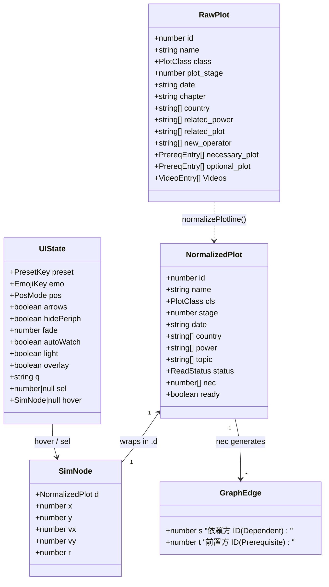

# AI 維護速查手冊：行號熱區、資料型別、函式索引表與呼叫圖 (`v1`)

- **文件性質 (Type)**：Living Technical Reference（專供 AI Agent 快速定位程式碼與節省 Context 瀏覽時間）
- **對應主程式 (`v1` 唯一預設入口)**：[`/index.html`](file:///m:/Github/ArkPlots-Graph/index.html)（**`theme:PRTS` 羅德島戰術終端版**，共 2,138 行）
- **對應主題與匯出模組**：
  - 🚧 開發預覽版：[`/themes/ArkPlots-Graph-endfield.html`](file:///m:/Github/ArkPlots-Graph/themes/ArkPlots-Graph-endfield.html)（`theme:終末地` 塔衛二工程藍圖版，共 2,113 行）
  - 🛠️ 開發簡約版：[`/themes/ArkPlots-Graph-dev.html`](file:///m:/Github/ArkPlots-Graph/themes/ArkPlots-Graph-dev.html)（保持外觀極簡的開發測試版，共 1,567 行）
  - 🗄️ 已封存棄用版：[`/themes/deprecated/`](file:///m:/Github/ArkPlots-Graph/themes/deprecated)（`liquid-glass` 與 `retro-pixel`，**停止維護更新**）
  - 📓 Obsidian 匯出器：[`/obsidian/tools/*.py`](file:///m:/Github/ArkPlots-Graph/obsidian/tools/arkplots_core.py)
- **關聯架構決策**：
  - [ADR-001：同級並排獨立 Repo、零污染隔離與 `v1` 多主題版本分層架構](file:///m:/Github/ArkPlots-Graph/docs/adr/ADR-001-arkplots-graph-architecture.md)
  - [ADR-002：單向資料流與雙層持久化記憶](file:///m:/Github/ArkPlots-Graph/docs/adr/ADR-002-persistence-and-data-flow.md)
  - [ADR-003：主圖優先版面、2x 物理間距、雙向拓撲關聯線與 PRTS 視覺 UX](file:///m:/Github/ArkPlots-Graph/docs/adr/ADR-003-hero-canvas-and-bidirectional-edges.md)

---

## 1. 檔案行號熱區索引 (File Map & Line-Range Hotspots — 以預設版 `index.html` 為基準)

> [!TIP]
> **給後續維護的 AI Agent**：[`index.html`](file:///m:/Github/ArkPlots-Graph/index.html) 中 **第 734 行是內嵌的 134 部劇情單行 JSON 快照 (`DEFAULT_DATA`，預設全部為 `"未读"`)**。請直接根據下表鎖定行號區間呼叫 `view_file(StartLine, EndLine)`，無須從頭掃描整份檔案。

| 區段名稱 | 行號區間 (`index.html` PRTS 版) | 行號區間 (`themes/ArkPlots-Graph-dev.html` 簡約版) | 職責說明與常見修改場景 |
| --- | --- | --- | --- |
| **1. CSS 變數、PRTS 戰術切角與原生 Layout 保底** | [`L1–L529`](file:///m:/Github/ArkPlots-Graph/index.html#L1-L529) | [`L1–L220`](file:///m:/Github/ArkPlots-Graph/themes/ArkPlots-Graph-dev.html#L1-L220) | 深色 PRTS 終端 (`:root`) 與淺色醫療室 (`html.light`) 變數、`.prts-panel` 45° 切角、`#prtsOverlay` 點陣掃描線、`.chip` 反色高亮、無外網原生 CSS Fallback |
| **2. HTML DOM 結構（頂部雷達畫布＋下方四欄設定）** | [`L530–L727`](file:///m:/Github/ArkPlots-Graph/index.html#L530-L727) | [`L221–L380`](file:///m:/Github/ArkPlots-Graph/themes/ArkPlots-Graph-dev.html#L221-L380) | PRTS 頂部導覽列 (`v1`)、滿版畫布 `<canvas id="graph">`、右側懸浮檔案卡 `#selCard`、左下角 `#legend`、Hover 卡片 `#tip`、下方四欄 `#settingsSection`（含 `#sanityBarFill` 理智同步率條） |
| **3. 內嵌預設資料快照 (`DEFAULT_DATA`)** | [`L728–L738`](file:///m:/Github/ArkPlots-Graph/index.html#L728-L738) | [`L381–L395`](file:///m:/Github/ArkPlots-Graph/themes/ArkPlots-Graph-dev.html#L381-L395) | 134 部預清理後的 `NormalizedPlot[]` 陣列（預設全數 `"status": "未读"`）、`DEFAULT_RECORDS`、`VALID_STATUSES` |
| **4. 儲存層與 IndexedDB Handle 管理** | [`L739–L831`](file:///m:/Github/ArkPlots-Graph/index.html#L739-L831) | [`L396–L485`](file:///m:/Github/ArkPlots-Graph/themes/ArkPlots-Graph-dev.html#L396-L485) | `STORAGE_KEYS`、`openHandleDB()`、`saveFileHandle()`、`loadFileHandle()`、`clearFileHandles()`、`safeGetLS/SetLS/RemoveLS()` |
| **5. 資料清理與拓撲狀態計算引擎** | [`L832–L949`](file:///m:/Github/ArkPlots-Graph/index.html#L832-L949) | [`L486–L607`](file:///m:/Github/ArkPlots-Graph/themes/ArkPlots-Graph-dev.html#L486-L607) | `normalizePlotline()`、`normalizeRecords()`、全域圖譜變數 (`DATA`, `byId`, `EDGES`, `deg`, `inDeg`)、`recomputeGraphState()` |
| **6. 配色群組、Emoji 方案與 UI 面板渲染** | [`L950–L1204`](file:///m:/Github/ArkPlots-Graph/index.html#L950-L1204) | [`L608–L811`](file:///m:/Github/ArkPlots-Graph/themes/ArkPlots-Graph-dev.html#L608-L811) | `getPresets()`（含 `prts_tactical`）、`EMO`、UI 狀態 `S`、`persistUIState()`、`stem()`、`colorOf()`、`updateSourcePanel()`、`buildPresets()`、`buildEmojis()`、`refresh()`、`renderSide()` |
| **7. 力導向模擬 (2x 間距)、雙向關聯遍歷與 PRTS Canvas 繪圖** | [`L1205–L1671`](file:///m:/Github/ArkPlots-Graph/index.html#L1205-L1671) | [`L812–L1093`](file:///m:/Github/ArkPlots-Graph/themes/ArkPlots-Graph-dev.html#L812-L1093) | `rebuildNodesSimulation()`、`tick()`（2x 間距：`9200/d2`, `L0=145`）、`resize()`、`ancestors()`（實線）、`directSuccessors()`（虛線）、`getCoverCandidates()`、`updateSelectedPanel()`、`drawPrtsNode()`、`draw()` |
| **8. 滑鼠／滾輪／鍵盤互動與 Hover 封面** | [`L1672–L1750`](file:///m:/Github/ArkPlots-Graph/index.html#L1672-L1750) | [`L1094–L1172`](file:///m:/Github/ArkPlots-Graph/themes/ArkPlots-Graph-dev.html#L1094-L1172) | `toWorld()`、`pick()`、`pointerdown/move/leave/up`（含 `#tip` 封面載入與 `lastTipKey` 防閃爍）、`wheel` 縮放、`Escape` 取消選取 |
| **9. 檔案綁定、自動監聽與測試公開 API** | [`L1751–L2138`](file:///m:/Github/ArkPlots-Graph/index.html#L1751-L2138) | [`L1173–L1567`](file:///m:/Github/ArkPlots-Graph/themes/ArkPlots-Graph-dev.html#L1173-L1567) | `applyRecordsData()`、`applyPlotlineData()`、`readFromRecordHandle()`、`initPersistence()`、Drag & Drop、2.5s `setInterval` 自動監聽、`window.ArkPlotsGraph` |

---

## 2. 核心資料型別與介面定義 (Data Types & Interfaces)

### 2.1 資料模型關係圖 (Class Diagram)

### 2.2 資料型別詳細規格表 (Type Definitions Table)

| 型別名稱 (Type / Interface) | 欄位與型別簽章 (Fields & Types) | 來源 / 產生位置 (`index.html`) | 用途與不變量 (Invariants) |
| --- | --- | --- | --- |
| `ReadStatus` | `'未读' \| '计划读' \| '正在读' \| '已读'` | `VALID_STATUSES` ([`L737`](file:///m:/Github/ArkPlots-Graph/index.html#L737)) | 合法閱讀狀態枚舉；任何未知字串皆正規化為 `'未读'` |
| `PlotClass` | `'main' \| 'sidestory' \| 'ministory' \| 'rougelike' \| 'RA' \| 'manga' \| 'anime' \| 'other'` | `CLS_ZH` ([`L921`](file:///m:/Github/ArkPlots-Graph/index.html#L921)) | 劇情作品分類；其中 `manga`、`anime`、`other` 屬於 `PERIPH`（周邊作品） |
| `NormalizedPlot` | `{ id: number, name: string, cls: PlotClass, stage: number, date: string, country: string[], power: string[], topic: string[], status: ReadStatus, nec: number[], ready: boolean }` | `normalizePlotline()` ([`L833`](file:///m:/Github/ArkPlots-Graph/index.html#L833)) 與 `recomputeGraphState()` ([`L925`](file:///m:/Github/ArkPlots-Graph/index.html#L925)) | 前端引擎標準劇情物件（存於 `DATA[]` 與 `byId`）；`nec` 保證無重複、無自身 ID、且目標必存在於 `byId`；`ready` 表示所有 `nec` 皆為 `'已读'` |
| `SimNode` | `{ d: NormalizedPlot, x: number, y: number, vx: number, vy: number, r: number }` | `rebuildNodesSimulation()` ([`L1224`](file:///m:/Github/ArkPlots-Graph/index.html#L1224)) | 力導向圖模擬節點（存於 `N[]` 與 `NI: Map<number, SimNode>`）；半徑 `r = 5 + Math.sqrt(deg.get(d.id) \|\| 0) * 2.6` |
| `GraphEdge` | `{ s: number, t: number }` | `recomputeGraphState()` ([`L937`](file:///m:/Github/ArkPlots-Graph/index.html#L937)) | 有向依賴邊（存於 `EDGES[]`）：**`s` 為後期劇情（依賴方），`t` 為必要前置劇情（被依賴方）**。Canvas 繪製箭頭由 `a (e.s)` 指向 `b (e.t)` |
| `PresetConfig` | `{ key: 'prts_tactical'\|'status'\|'action'\|'class'\|'stage'\|'country', title: string, tag?: string, desc: string, groups: PresetGroup[] }` | `getPresets()` ([`L950`](file:///m:/Github/ArkPlots-Graph/index.html#L950)) | 6 套色彩主軸方案設定（預設為 `'prts_tactical'` 羅德島 PRTS 戰術光譜） |
| `UIState` (`S`) | `{ preset: string, emo: string, pos: 'prefix'\|'suffix', arrows: boolean, hidePeriph: boolean, fade: number, autoWatch: boolean, light: boolean, overlay: boolean, q: string, sel: number\|null, hover: SimNode\|null }` | 全域常數 `S` ([`L993`](file:///m:/Github/ArkPlots-Graph/index.html#L993)) | 單一響應式 UI 狀態中心；前 9 個屬性會持久化至 `localStorage`，預設選取 `sel: 68`（孤星）以展示雙向關聯線與右側檔案卡 |

---

## 3. 前端引擎關鍵函式速查表 (`index.html` PRTS 預設版)

### 3.1 儲存與資料清理層函式 (`L749–L948`)

| 函式名稱與簽章 | 行號 (`index.html`) | 用途說明 |
| --- | --- | --- |
| [`openHandleDB()`](file:///m:/Github/ArkPlots-Graph/index.html#L749-L764) / [`saveFileHandle()`](file:///m:/Github/ArkPlots-Graph/index.html#L766-L779) / [`loadFileHandle()`](file:///m:/Github/ArkPlots-Graph/index.html#L781-L794) / [`clearFileHandles()`](file:///m:/Github/ArkPlots-Graph/index.html#L796-L809) | `L749–L809` | 管理 `IndexedDB` (`ArkPlotsGraphDB`) 中的 `FileSystemFileHandle` 持久化讀寫 |
| [`normalizePlotline(rawInput)`](file:///m:/Github/ArkPlots-Graph/index.html#L833-L887) | `L833–L887` | 清理上游 `Plotline.json`，剔除自我參照、重複前置與誤植的影片 URL |
| [`normalizeRecords(rawObj)`](file:///m:/Github/ArkPlots-Graph/index.html#L889-L909) | `L889–L909` | 驗證並正規化 `Read_record.json` 鍵值對 |
| [`recomputeGraphState()`](file:///m:/Github/ArkPlots-Graph/index.html#L925-L946) | `L925–L946` | 重算所有劇情的 `status`、`ready`、`byId`、`EDGES`、`deg`、`inDeg` 與 `topCountries` |

### 3.2 視覺映射、力導向模擬與 PRTS 雷達渲染函式 (`L950–L1671`)

| 函式名稱與簽章 | 行號 (`index.html`) | 用途說明 |
| --- | --- | --- |
| [`getPresets()`](file:///m:/Github/ArkPlots-Graph/index.html#L950-L981) | `L950–L981` | 動態產生 6 套顏色主軸定義（含預設 `prts_tactical`） |
| [`updateSourcePanel(meta)`](file:///m:/Github/ArkPlots-Graph/index.html#L1046-L1073) | `L1046–L1073` | 更新各狀態統計、PRTS 理智與同步率進度條 (`#sanityBarFill`, `#prtsSyncText`, `#prtsReadyText`) 與綁定檔名 |
| [`refresh()`](file:///m:/Github/ArkPlots-Graph/index.html#L1140-L1145) / [`renderSide()`](file:///m:/Github/ArkPlots-Graph/index.html#L1147-L1199) | `L1140–L1199` | 全域 UI 總刷新入口；重新計算 `#legend`, `#insight`, `#names`, `#warn`, `#json` |
| [`rebuildNodesSimulation(keepPositions)`](file:///m:/Github/ArkPlots-Graph/index.html#L1224-L1240) | `L1224–L1240` | 以固定種子 `seededRand()` 與 `2400 × 1300` 跨度初始化節點座標與半徑 |
| [`tick()`](file:///m:/Github/ArkPlots-Graph/index.html#L1246-L1260) | `L1246–L1260` | **2x 間距物理模擬**：庫侖斥力 (`9200/d2`, `d2 <= 1000000`)、虎克彈簧引力（目標長 `145`）與中心向心力 (`0.0018 / 0.0028`) |
| [`resize()`](file:///m:/Github/ArkPlots-Graph/index.html#L1262-L1272) | `L1262–L1272` | 響應容器尺寸變更，配置高解析度 `DPR` 畫布與初始縮放比例 `Math.min(Math.max(600, W - 340) / 1850, H / 980)` |
| [`ancestors(id)`](file:///m:/Github/ArkPlots-Graph/index.html#L1274-L1283) / [`directSuccessors(id)`](file:///m:/Github/ArkPlots-Graph/index.html#L1285-L1291) | `L1274–L1291` | 上游必要前置閉包（羅德島青實線 `━━`）與下一層 1-hop 後續劇情查詢（源石琥珀虛線 `╌╌`） |
| [`getCoverCandidates(id)`](file:///m:/Github/ArkPlots-Graph/index.html#L1294-L1318) | `L1294–L1318` | 回傳該劇情封面的多層備援路徑陣列（同時相容根目錄 `../arknight-tool-ArkPlots/` 與 `themes/` 子目錄 `../../arknight-tool-ArkPlots/`） |
| [`updateSelectedPanel()`](file:///m:/Github/ArkPlots-Graph/index.html#L1330-L1437) | `L1330–L1437` | 渲染右側懸浮 PRTS 作戰檔案卡 (`#selCard`)：顯示封面、標籤、實線直屬前置、虛線下一層劇情與建議補齊順序 |
| [`drawPrtsNode(...)`](file:///m:/Github/ArkPlots-Graph/index.html#L1440-L1528) | `L1440–L1528` | 繪製 PRTS 菱形算子節點、主線雙層內核、選取態 `[ + ]` 戰術鎖定準星與下一層琥珀虛線外框 |
| [`draw()`](file:///m:/Github/ArkPlots-Graph/index.html#L1530-L1668) | `L1530–L1668` | Canvas 主渲染器：繪製同心圓戰術雷達底圖、實線/虛線有向邊、菱形節點、`PRTS // TARGET` 銘牌與高對比文字標籤 |

### 3.3 互動、檔案同步與公開 API 函式 (`L1672–L2125`)

| 函式名稱與簽章 | 行號 (`index.html`) | 用途說明 |
| --- | --- | --- |
| [`toWorld(cx, cy)`](file:///m:/Github/ArkPlots-Graph/index.html#L1675) / [`pick(cx, cy)`](file:///m:/Github/ArkPlots-Graph/index.html#L1676) | `L1675–L1676` | 螢幕座標轉世界座標與節點命中測試（半徑 `n.r * 1.15 + 4 / T.k`） |
| [`applyRecordsData()`](file:///m:/Github/ArkPlots-Graph/index.html#L1756-L1771) / [`applyPlotlineData()`](file:///m:/Github/ArkPlots-Graph/index.html#L1773-L1784) | `L1756–L1784` | 套用新載入的 `Read_record.json` 或 `Plotline.json` 並刷新整張圖譜與統計 |
| [`readFromRecordHandle()`](file:///m:/Github/ArkPlots-Graph/index.html#L1810-L1850) / [`initPersistence()`](file:///m:/Github/ArkPlots-Graph/index.html#L2057-L2099) | `L1810–L2099` | 啟動 0 點擊快取還原與 `IndexedDB` 本機檔案靜默同步 |
| [`window.ArkPlotsGraph`](file:///m:/Github/ArkPlots-Graph/index.html#L2102-L2125) | `L2102–L2125` | 自動化測試與外部腳本公開 API（`selectNode`, `getState`, `applyRecordsData`, `applyPlotlineData`） |

---

## 4. Python Obsidian 匯出器函式速查表 (`obsidian/tools/*.py`)

| 模組檔案 | 函式名稱與簽章 | 行號 | 用途說明 |
| --- | --- | --- | --- |
| [`arkplots_core.py`](file:///m:/Github/ArkPlots-Graph/obsidian/tools/arkplots_core.py) | [`_resolve_upstream_root()`](file:///m:/Github/ArkPlots-Graph/obsidian/tools/arkplots_core.py#L20-L27) | `L20–L27` | 自動偵測 `Plotline.json` 位於當前目錄或同級並排的 `../arknight-tool-ArkPlots` |
| [`arkplots_core.py`](file:///m:/Github/ArkPlots-Graph/obsidian/tools/arkplots_core.py) | [`load_plots()`](file:///m:/Github/ArkPlots-Graph/obsidian/tools/arkplots_core.py#L92-L130) / [`load_status()`](file:///m:/Github/ArkPlots-Graph/obsidian/tools/arkplots_core.py#L138-L152) | `L92–L152` | 唯讀載入並清理上游 `Plotline.json` 與隔離區的 `user_data/Read_record.json` |
| [`export_notes.py`](file:///m:/Github/ArkPlots-Graph/obsidian/tools/export_notes.py) | [`export_notes(plots, status, anomalies)`](file:///m:/Github/ArkPlots-Graph/obsidian/tools/export_notes.py#L360-L457) | `L360–L457` | 同步封面至 `Covers/`、產生 `Plots/*.md`、`ArkPlots.base` 與 `ArkPlots 首页.md` |
| [`export_canvas.py`](file:///m:/Github/ArkPlots-Graph/obsidian/tools/export_canvas.py) | [`export_canvases(plots, status, with_optional)`](file:///m:/Github/ArkPlots-Graph/obsidian/tools/export_canvas.py#L922-L969) | `L922–L969` | 驗證並冪等輸出全部 6 張 `.canvas` 檔案（`S1–S4`、`骨干`、`阅读计划`） |
| [`run_all.py`](file:///m:/Github/ArkPlots-Graph/obsidian/tools/run_all.py) | [`main()`](file:///m:/Github/ArkPlots-Graph/obsidian/tools/run_all.py#L22-L36) | `L22–L36` | CLI 總入口：一鍵執行完整 Obsidian Vault 匯出 |
