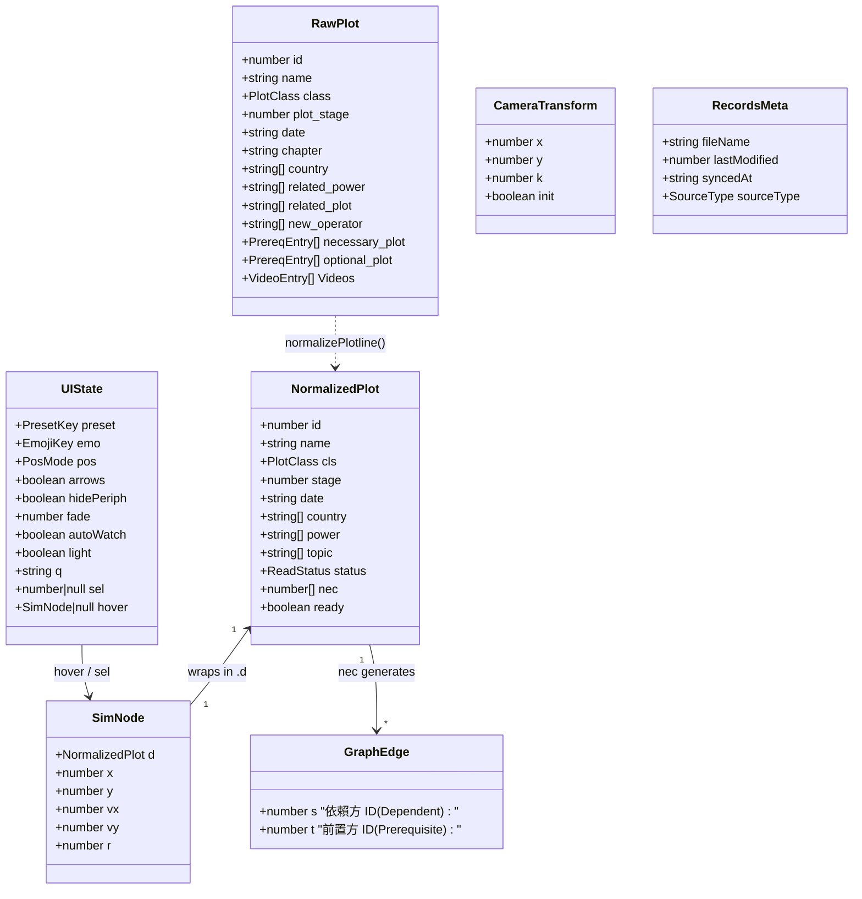
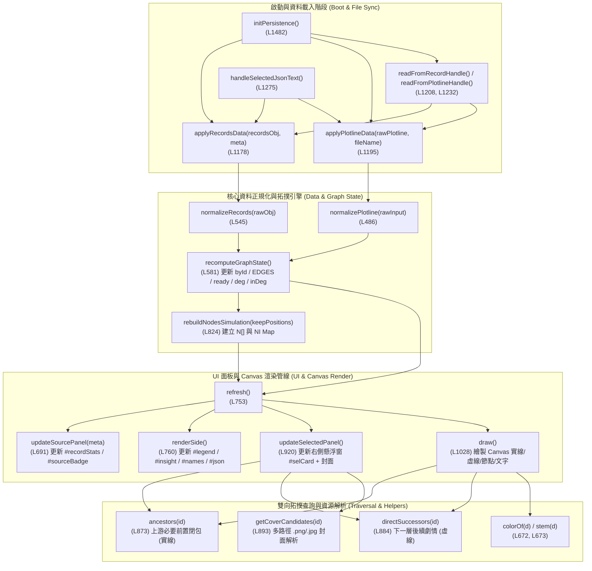

# AI 維護速查手冊：行號熱區、資料型別、函式索引表與呼叫圖

- **文件性質 (Type)**：Living Technical Reference（專供 AI Agent 快速定位程式碼與節省 Context 瀏覽時間）
- **對應主程式**：[`/index.html`](file:///m:/Github/ArkPlots-Graph/index.html)（與 [`/ArkPlots-Graph.html`](file:///m:/Github/ArkPlots-Graph/ArkPlots-Graph.html)，共 1,564 行）及 [`/obsidian/tools/*.py`](file:///m:/Github/ArkPlots-Graph/obsidian/tools/arkplots_core.py)
- **關聯架構決策**：
  - [ADR-001：同級並排獨立 Repo、零污染隔離與單一入口架構](file:///m:/Github/ArkPlots-Graph/docs/adr/ADR-001-arkplots-graph-architecture.md)
  - [ADR-002：單向資料流與雙層持久化記憶](file:///m:/Github/ArkPlots-Graph/docs/adr/ADR-002-persistence-and-data-flow.md)
  - [ADR-003：主圖優先版面、雙向拓撲關聯線與封面預覽 UX](file:///m:/Github/ArkPlots-Graph/docs/adr/ADR-003-hero-canvas-and-bidirectional-edges.md)

---

## 1. 檔案行號熱區索引 (File Map & Line-Range Hotspots)

> [!TIP]
> **給後續維護的 AI Agent**：[`index.html`](file:///m:/Github/ArkPlots-Graph/index.html) 中 **第 252 行至第 387 行是內嵌的 134 部劇情 JSON 快照 (`DEFAULT_DATA`)**。請直接根據下表鎖定行號區間呼叫 `view_file(StartLine, EndLine)`，無須從頭掃描整份檔案。

| 區段名稱 | 行號區間 (`index.html`) | 職責說明與常見修改場景 |
| --- | --- | --- |
| **1. CSS 變數與原生 Layout 保底** | [`L1–L138`](file:///m:/Github/ArkPlots-Graph/index.html#L1-L138) | 深淺色 CSS 變數 (`:root`, `html.light`)、`.card`、`.floating-panel`、`.jump-pill`、四欄設定網格 (`#settingsSection`)、無外網環境下的原生 CSS 保底規則 |
| **2. HTML DOM 結構（頂部畫布＋下方設定）** | [`L139–L251`](file:///m:/Github/ArkPlots-Graph/index.html#L139-L251) | Header 列、滿版畫布 `<canvas id="graph">`、右側懸浮窗 `#selCard`、左下角 `#legend`、Hover 卡片 `#tip`、下方四欄 `#settingsSection` |
| **3. 內嵌預設資料快照 (`DEFAULT_DATA`)** | [`L252–L387`](file:///m:/Github/ArkPlots-Graph/index.html#L252-L387) | 134 部預清理後的 `NormalizedPlot[]` 陣列、`DEFAULT_RECORDS`、`VALID_STATUSES`（**一般維護時可跳過不讀**） |
| **4. 儲存層與 IndexedDB Handle 管理** | [`L388–L480`](file:///m:/Github/ArkPlots-Graph/index.html#L388-L480) | `STORAGE_KEYS`、`openHandleDB()`、`saveFileHandle()`、`loadFileHandle()`、`clearFileHandles()`、`safeGetLS/SetLS/RemoveLS()` |
| **5. 資料清理與拓撲狀態計算引擎** | [`L481–L607`](file:///m:/Github/ArkPlots-Graph/index.html#L481-L607) | `normalizePlotline()`、`normalizeRecords()`、全域圖譜變數 (`DATA`, `byId`, `EDGES`, `deg`, `inDeg`)、`recomputeGraphState()` |
| **6. 配色群組、Emoji 方案與 UI 面板渲染** | [`L608–L811`](file:///m:/Github/ArkPlots-Graph/index.html#L608-L811) | `getPresets()`、`EMO`、UI 狀態 `S`、`persistUIState()`、`stem()`、`colorOf()`、`buildPresets()`、`buildEmojis()`、`refresh()`、`renderSide()` |
| **7. 力導向模擬、雙向關聯遍歷與 Canvas 繪圖** | [`L812–L1093`](file:///m:/Github/ArkPlots-Graph/index.html#L812-L1093) | `rebuildNodesSimulation()`、`tick()`、`resize()`、`ancestors()`（實線）、`directSuccessors()`（虛線）、`getCoverCandidates()`、`updateSelectedPanel()`、`draw()` |
| **8. 滑鼠／滾輪／鍵盤互動與 Hover 封面** | [`L1094–L1172`](file:///m:/Github/ArkPlots-Graph/index.html#L1094-L1172) | `toWorld()`、`pick()`、`pointerdown/move/leave/up`（含 `#tip` 封面載入與 `lastTipKey` 防閃爍）、`wheel` 縮放、`Escape` 取消選取 |
| **9. 檔案綁定、自動監聽與測試公開 API** | [`L1173–L1564`](file:///m:/Github/ArkPlots-Graph/index.html#L1173-L1564) | `applyRecordsData()`、`applyPlotlineData()`、`readFromRecordHandle()`、`initPersistence()`、Drag & Drop、2.5s `setInterval` 自動監聽、`window.ArkPlotsGraph` |

---

## 2. 核心資料型別與介面定義 (Data Types & Interfaces)

### 2.1 資料模型關係圖 (Class Diagram)

### 2.2 資料型別詳細規格表 (Type Definitions Table)

| 型別名稱 (Type / Interface) | 欄位與型別簽章 (Fields & Types) | 來源 / 產生位置 | 用途與不變量 (Invariants) |
| --- | --- | --- | --- |
| `ReadStatus` | `'未读' \| '计划读' \| '正在读' \| '已读'` | `VALID_STATUSES` ([`L386`](file:///m:/Github/ArkPlots-Graph/index.html#L386)) | 合法閱讀狀態枚舉；任何未知字串皆正規化為 `'未读'` |
| `PlotClass` | `'main' \| 'sidestory' \| 'ministory' \| 'rougelike' \| 'RA' \| 'manga' \| 'anime' \| 'other'` | `CLS_ZH` ([`L577`](file:///m:/Github/ArkPlots-Graph/index.html#L577)) | 劇情作品分類；其中 `manga`、`anime`、`other` 屬於 `PERIPH`（周邊作品） |
| `RawPlot` | `{ id: number, name: string, class: PlotClass, plot_stage: 1\|2\|3\|4, date: string, necessary_plot: Array<{id?: number, reason?: string, url?: string}>, optional_plot: Array<...>, Videos: Array<{name: string, url: string}> }` | 上游 `Plotline.json` 的 `data[]` 陣列元素 | 原始上游資料結構；注意 `necessary_plot` 內含 4 筆歷史髒資料（自我依賴、重複 ID、誤置影片 URL） |
| `NormalizedPlot` | `{ id: number, name: string, cls: PlotClass, stage: number, date: string, country: string[], power: string[], topic: string[], status: ReadStatus, nec: number[], ready: boolean }` | `normalizePlotline()` ([`L486`](file:///m:/Github/ArkPlots-Graph/index.html#L486)) 與 `recomputeGraphState()` ([`L581`](file:///m:/Github/ArkPlots-Graph/index.html#L581)) | 前端引擎標準劇情物件（存於 `DATA[]` 與 `byId`）；`nec` 保證無重複、無自身 ID、且目標必存在於 `byId`；`ready` 表示所有 `nec` 皆為 `'已读'` |
| `SimNode` | `{ d: NormalizedPlot, x: number, y: number, vx: number, vy: number, r: number }` | `rebuildNodesSimulation()` ([`L824`](file:///m:/Github/ArkPlots-Graph/index.html#L824)) | 力導向圖模擬節點（存於 `N[]` 與 `NI: Map<number, SimNode>`）；半徑 `r = 4 + Math.sqrt(deg.get(d.id) \|\| 0) * 2.6` |
| `GraphEdge` | `{ s: number, t: number }` | `recomputeGraphState()` ([`L595`](file:///m:/Github/ArkPlots-Graph/index.html#L595)) | 有向依賴邊（存於 `EDGES[]`）：**`s` 為後期劇情（依賴方），`t` 為必要前置劇情（被依賴方）**。Canvas 繪製箭頭由 `a (e.s)` 指向 `b (e.t)` |
| `PresetGroup` | `{ label: string, query: string, color: string, m: (d: NormalizedPlot) => boolean }` | `getPresets()` ([`L608`](file:///m:/Github/ArkPlots-Graph/index.html#L608)) | 單一顏色群組規則；`m(d)` 為節點命中測試函式（採 First-match wins），`query` 用於輸出 Obsidian `graph.json` |
| `PresetConfig` | `{ key: 'status'\|'action'\|'class'\|'stage'\|'country', title: string, tag?: string, desc: string, groups: PresetGroup[] }` | `getPresets()` ([`L608`](file:///m:/Github/ArkPlots-Graph/index.html#L608)) | 5 套色彩主軸方案設定 |
| `EmojiScheme` | `{ title: string, desc: string, bad?: boolean, f: (d: NormalizedPlot) => string }` | `EMO` ([`L634`](file:///m:/Github/ArkPlots-Graph/index.html#L634)) | 節點名稱 Emoji 映射規則（`none` / `cls` / `stage` / `status`） |
| `UIState` (`S`) | `{ preset: string, emo: string, pos: 'prefix'\|'suffix', arrows: boolean, hidePeriph: boolean, fade: number, autoWatch: boolean, light: boolean, q: string, sel: number\|null, hover: SimNode\|null }` | 全域常數 `S` ([`L642`](file:///m:/Github/ArkPlots-Graph/index.html#L642)) | 單一響應式 UI 狀態中心；前 8 個屬性會持久化至 `localStorage`，後 3 個（`q`, `sel`, `hover`）為執行期互動狀態 |
| `CameraTransform` (`T`) | `{ x: number, y: number, k: number, init?: boolean }` | 全域常數 `T` ([`L815`](file:///m:/Github/ArkPlots-Graph/index.html#L815)) | Canvas 2D 視角轉換矩陣參數（平移 `x, y` 與縮放倍率 `k ∈ [0.15, 4]`） |
| `DragState` (`drag`) | `{ node: SimNode\|null, pan: boolean, sx: number, sy: number, moved: boolean }` | 全域常數 `drag` ([`L1095`](file:///m:/Github/ArkPlots-Graph/index.html#L1095)) | 指標拖曳狀態機（區分「拖曳單一節點」、「平移畫布」與「原地點擊選取節點」） |
| `RecordsMeta` | `{ fileName: string, lastModified: number, syncedAt: string, sourceType: 'handle'\|'cache'\|'file' }` | `readFromRecordHandle()` / `handleSelectedJsonText()` | 記錄目前綁定或快取的 `Read_record.json` 來源元資料 |

---

## 3. 前端引擎完整函式速查表 (Frontend JS Function Reference)

### 3.1 函式呼叫與渲染管線圖 (Call & Render Pipeline)

### 3.2 儲存與持久化層函式 (`L398–L479`, `L656–L667`)

| 函式名稱與簽章 | 行號 (`index.html`) | 輸入型別 | 回傳型別 | 讀寫之全域狀態 / 副作用 | 用途說明 |
| --- | --- | --- | --- | --- | --- |
| [`openHandleDB()`](file:///m:/Github/ArkPlots-Graph/index.html#L398-L413) | `L398–L413` | `()` | `Promise<IDBDatabase \| null>` | 開啟 IndexedDB `ArkPlotsGraphDB` (v1)，自動建立 `file_handles` objectStore | 取得儲存 `FileSystemFileHandle` 的資料庫連線（若環境不支援則優雅降級回傳 `null`） |
| [`saveFileHandle(key, handle)`](file:///m:/Github/ArkPlots-Graph/index.html#L415-L428) | `L415–L428` | `(key: 'read_record'\|'plotline', handle: FileSystemFileHandle)` | `Promise<boolean>` | 寫入 IndexedDB `file_handles[key]` | 將使用者授權過的本機檔案 Handle 永久存入 IndexedDB，下次開啟免重新選檔 |
| [`loadFileHandle(key)`](file:///m:/Github/ArkPlots-Graph/index.html#L430-L443) | `L430–L443` | `(key: 'read_record'\|'plotline')` | `Promise<FileSystemFileHandle \| null>` | 讀取 IndexedDB `file_handles[key]` | 啟動或點擊「重新同步」時取回已記住的本機檔案控制代碼 |
| [`clearFileHandles()`](file:///m:/Github/ArkPlots-Graph/index.html#L445-L458) | `L445–L458` | `()` | `Promise<void>` | 清空 IndexedDB `file_handles` | 點擊「重置為內建快照」時清除所有已綁定的檔案控制代碼 |
| [`safeGetLS(key)`](file:///m:/Github/ArkPlots-Graph/index.html#L460-L467) | `L460–L467` | `(key: string)` | `any \| null` | 讀取 `localStorage` 並 `JSON.parse` | 安全讀取 `localStorage` JSON 快取，攔截無痕模式或損毀 JSON 例外 |
| [`safeSetLS(key, val)`](file:///m:/Github/ArkPlots-Graph/index.html#L469-L473) | `L469–L473` | `(key: string, val: any)` | `void` | 寫入 `localStorage` | 安全序列化並寫入 `localStorage` |
| [`safeRemoveLS(key)`](file:///m:/Github/ArkPlots-Graph/index.html#L475-L479) | `L475–L479` | `(key: string)` | `void` | 移除 `localStorage` 指定鍵 | 安全刪除 `localStorage` 快取項目 |
| [`persistUIState()`](file:///m:/Github/ArkPlots-Graph/index.html#L656-L667) | `L656–L667` | `()` | `void` | 讀取 `S`，寫入 `localStorage['arkplots_graph.ui_state.v1']` | 將使用者切換的配色、Emoji、文字淡出、深淺主題等 UI 偏好即時持久化 |

### 3.3 資料清理與拓撲狀態引擎函式 (`L486–L606`)

| 函式名稱與簽章 | 行號 (`index.html`) | 輸入型別 | 回傳型別 | 讀寫之全域狀態 / 副作用 | 用途說明 |
| --- | --- | --- | --- | --- | --- |
| [`normalizePlotline(rawInput)`](file:///m:/Github/ArkPlots-Graph/index.html#L486-L540) | `L486–L540` | `(rawInput: {data: RawPlot[]} \| NormalizedPlot[])` | `{ plots: NormalizedPlot[], anomalies: string[] }` | 純函式（讀取 `VALID_STATUSES`） | 同時相容上游原始 `Plotline.json` 與已正規化陣列；自動剔除自我參照、重複前置與誤植的影片 URL |
| [`normalizeRecords(rawObj)`](file:///m:/Github/ArkPlots-Graph/index.html#L545-L565) | `L545–L565` | `(rawObj: unknown)` | `Record<string, ReadStatus>` | 純函式（若誤傳 `Plotline.json` 或無效格式會拋出 `Error`） | 驗證並正規化 `Read_record.json` 鍵值對，確保每個數值 ID 對應合法 `ReadStatus` |
| [`recomputeGraphState()`](file:///m:/Github/ArkPlots-Graph/index.html#L581-L604) | `L581–L604` | `()` | `void` | **核心狀態更新**：修改 `DATA[i].status`、`DATA[i].ready`，重建 `byId`、`EDGES`、`deg`、`inDeg`、`topCountries` | 每當 `DATA` 或 `currentRecords` 變更時呼叫，重新計算所有劇情的閱讀狀態、`prereq_ready`、有向邊與出入度統計 |

### 3.4 視覺映射與設定面板渲染函式 (`L608–L810`)

| 函式名稱與簽章 | 行號 (`index.html`) | 輸入型別 | 回傳型別 | 讀寫之全域狀態 / 副作用 | 用途說明 |
| --- | --- | --- | --- | --- | --- |
| [`getPresets()`](file:///m:/Github/ArkPlots-Graph/index.html#L608-L631) | `L608–L631` | `()` | `PresetConfig[]` | 讀取 `CLS_ZH`, `topCountries`, `CPAL` | 動態產生 5 套顏色主軸定義（`status` 閱讀狀態、`action` 下一步讀什麼、`class` 作品類型、`stage` 階段、`country` 地區前 7 名） |
| [`pad(n)`](file:///m:/Github/ArkPlots-Graph/index.html#L671) | `L671` | `(n: number\|string)` | `string` | 純函式 | 將劇情 ID 補零為 3 位數字字串（如 `68 → "068"`） |
| [`stem(d)`](file:///m:/Github/ArkPlots-Graph/index.html#L672) | `L672` | `(d: NormalizedPlot)` | `string` | 讀取 `EMO`, `S.emo`, `S.pos` | 產生節點顯示名稱與 Obsidian 檔名主幹（如 `"068 📘 孤星"` 或 `"068 孤星"`） |
| [`colorOf(d)`](file:///m:/Github/ArkPlots-Graph/index.html#L673-L678) | `L673–L678` | `(d: NormalizedPlot)` | `string \| null` | 讀取 `S.preset`, `getPresets()` | 依目前選取的配色主軸回傳節點 HEX 色碼（未命中任何群組時回傳 `null`，由 `defaultColor()` 接手） |
| [`showSyncMessage(msg, isError)`](file:///m:/Github/ArkPlots-Graph/index.html#L683-L689) | `L683–L689` | `(msg: string, isError?: boolean)` | `void` | 更新 DOM `#syncMsg` | 在「閱讀紀錄資料來源」卡片底部顯示同步成功或錯誤提示訊息 |
| [`updateSourcePanel(meta)`](file:///m:/Github/ArkPlots-Graph/index.html#L691-L704) | `L691–L704` | `(meta?: RecordsMeta \| null)` | `void` | 讀取 `DATA`，更新 DOM `#recordStats`, `#recordFileName`, `#sourceBadge` | 更新各狀態統計人數（已讀／正在讀／計劃讀／未讀）與目前綁定檔名徽章 |
| [`buildPresets()`](file:///m:/Github/ArkPlots-Graph/index.html#L706-L715) | `L706–L715` | `()` | `void` | 更新 DOM `#presets` 並綁定點擊事件 | 渲染「1. 色彩主軸」選項卡列表 |
| [`buildEmojis()`](file:///m:/Github/ArkPlots-Graph/index.html#L717-L725) | `L717–L725` | `()` | `void` | 更新 DOM `#emojis` 並綁定點擊事件 | 渲染「2. 節點名稱加 emoji」選項卡列表與即時預覽 |
| [`refresh()`](file:///m:/Github/ArkPlots-Graph/index.html#L753-L758) | `L753–L758` | `()` | `void` | 依序呼叫 `updateSourcePanel()` → `renderSide()` → `updateSelectedPanel()` → `draw()` | **全域 UI 總刷新入口**：當任何狀態或資料變動後，同步更新所有 DOM 面板與 Canvas 畫布 |
| [`renderSide()`](file:///m:/Github/ArkPlots-Graph/index.html#L760-L804) | `L760–L804` | `()` | `void` | 更新 DOM `#legend`, `#insight`, `#names`, `#warn`, `#json` | 重新計算畫布左下角圖例計數、這套配色的洞察提示、檔名範例以及可複製的 Obsidian `graph.json` |

### 3.5 力導向圖模擬、拓撲遍歷與 Canvas 渲染函式 (`L816–L1093`)

| 函式名稱與簽章 | 行號 (`index.html`) | 輸入型別 | 回傳型別 | 讀寫之全域狀態 / 副作用 | 用途說明 |
| --- | --- | --- | --- | --- | --- |
| [`isLight()`](file:///m:/Github/ArkPlots-Graph/index.html#L816) / [`defaultColor()`](file:///m:/Github/ArkPlots-Graph/index.html#L817) | `L816–L817` | `()` | `boolean` / `string` | 讀取 `document.documentElement.classList` | 判斷目前是否為淺色主題，並回傳未命中群組節點的預設灰色色碼 |
| [`visible(d)`](file:///m:/Github/ArkPlots-Graph/index.html#L821) | `L821` | `(d: NormalizedPlot)` | `boolean` | 讀取 `S.hidePeriph`, `PERIPH` | 判斷節點是否應顯示（當勾選「隱藏周邊作品」時過濾掉漫畫、動畫、其他） |
| [`rebuildNodesSimulation(keepPositions)`](file:///m:/Github/ArkPlots-Graph/index.html#L824-L839) | `L824–L839` | `(keepPositions?: boolean)` | `void` | 重建全域 `N: SimNode[]` 與 `NI: Map<number, SimNode>` | 根據上線日期由左至右初始化節點座標與半徑；若 `keepPositions=true` 則保留既有節點座標避免畫面跳動 |
| [`heat(a)`](file:///m:/Github/ArkPlots-Graph/index.html#L843) | `L843` | `(a: number)` | `void` | 提升 `alpha` 溫度並呼叫 `renderSide()` | 重新喚醒力導向物理模擬（例如切換「隱藏周邊作品」或載入新 `Plotline.json` 時） |
| [`tick()`](file:///m:/Github/ArkPlots-Graph/index.html#L847-L861) | `L847–L861` | `()` | `void` | 更新 `N[i].x, y, vx, vy` 並衰減 `alpha *= 0.985` | 單步物理模擬：計算節點間庫侖斥力 (`9200/d2`, `d2 <= 1000000`)、連邊虎克彈簧引力（目標長 `145`）與中心向心力 (`0.0018 / 0.0028`) |
| [`resize()`](file:///m:/Github/ArkPlots-Graph/index.html#L861-L871) | `L861–L871` | `()` | `void` | 更新 `W, H, cv.width, cv.height, T` 並呼叫 `draw()` | 響應視窗或容器尺寸變更，重新配置高解析度 `DPR` 畫布與初始視角置中（預留右側 300px 給懸浮資訊窗） |
| [`ancestors(id)`](file:///m:/Github/ArkPlots-Graph/index.html#L873-L882) | `L873–L882` | `(id: number)` | `Set<number>` | 讀取 `byId`（純查詢） | **上游必要前置閉包（實線 `━━`）**：以 BFS 遞迴找出指定劇情 `id` 自身及所有直接／間接必要前置 ID 集合 |
| [`directSuccessors(id)`](file:///m:/Github/ArkPlots-Graph/index.html#L884-L890) | `L884–L890` | `(id: number)` | `Set<number>` | 讀取 `DATA`（純查詢） | **下一層後續劇情查詢（虛線 `╌╌`）**：找出所有 `d.nec.includes(id)` 的直屬下游劇情 ID 集合（1-hop） |
| [`getCoverCandidates(id)`](file:///m:/Github/ArkPlots-Graph/index.html#L893-L908) | `L893–L908` | `(id: number\|string)` | `string[]` | 讀取 `JPG_COVER_IDS`（純查詢） | 回傳該劇情封面的多層備援相對／絕對路徑陣列（自動優先選擇 `.jpg` 或 `.png`，支援跨目錄讀取 `../arknight-tool-ArkPlots/web/dist/covers/`） |
| [`statusBadgeHtml(st)`](file:///m:/Github/ArkPlots-Graph/index.html#L910-L918) | `L910–L918` | `(st: ReadStatus)` | `string` | 純函式 | 產生帶語意色彩邊框的閱讀狀態膠囊 HTML 字串 |
| [`updateSelectedPanel()`](file:///m:/Github/ArkPlots-Graph/index.html#L920-L1026) | `L920–L1026` | `()` | `void` | 讀取 `S.sel, byId`，更新 DOM `#selCard` 與 `#selCoverImg` | 渲染右側懸浮節點資訊窗：顯示封面圖（含 `onerror` 自動降級路徑）、地區／勢力標籤、實線直屬前置跳轉鈕、虛線下一層劇情跳轉鈕與未讀前置建議順序 |
| [`draw()`](file:///m:/Github/ArkPlots-Graph/index.html#L1028-L1090) | `L1028–L1090` | `()` | `void` | 讀取 `T, S, N, EDGES`，繪製 `<canvas id="graph">` | Canvas 核心渲染器：(1) 繪製連邊（選取節點之上游前置鏈畫**亮藍實線**、下一層後續劇情畫**琥珀金虛線** `[7, 4.5]`）；(2) 繪製節點與選取／下一層虛線外框；(3) 繪製節點標籤 |
| [`loop()`](file:///m:/Github/ArkPlots-Graph/index.html#L1092) | `L1092` | `()` | `void` | 排程 `requestAnimationFrame(loop)` | 當 `alpha > 0.02` 時每幀執行兩次 `tick()` 與一次 `draw()`，物理穩定後自動停止重繪以節省 GPU/CPU |

### 3.6 互動座標轉換、檔案同步與公開 API 函式 (`L1097–L1551`)

| 函式名稱與簽章 | 行號 (`index.html`) | 輸入型別 | 回傳型別 | 讀寫之全域狀態 / 副作用 | 用途說明 |
| --- | --- | --- | --- | --- | --- |
| [`toWorld(cx, cy)`](file:///m:/Github/ArkPlots-Graph/index.html#L1097) | `L1097` | `(cx: number, cy: number)` | `{ x: number, y: number }` | 讀取 `T` | 將 Canvas 螢幕像素座標轉換為物理世界座標 |
| [`pick(cx, cy)`](file:///m:/Github/ArkPlots-Graph/index.html#L1098) | `L1098` | `(cx: number, cy: number)` | `SimNode \| null` | 讀取 `N, T, visible` | 命中測試（Hit-testing）：找出游標座標下距離最近且在半徑 `n.r + 4/T.k` 內的節點 |
| [`rel(e)`](file:///m:/Github/ArkPlots-Graph/index.html#L1099) | `L1099` | `(e: PointerEvent \| WheelEvent)` | `[number, number]` | 讀取 `cv.getBoundingClientRect()` | 取得滑鼠事件相對於 Canvas 左上角的 `[x, y]` 座標 |
| [`applyRecordsData(recordsObj, meta)`](file:///m:/Github/ArkPlots-Graph/index.html#L1178-L1193) | `L1178–L1193` | `(recordsObj: object, meta?: RecordsMeta)` | `void` | 更新 `currentRecords`、寫入 `localStorage`、觸發 `recomputeGraphState()` 與 `refresh()` | 套用新載入的 `Read_record.json` 狀態物件並同步刷新整張圖譜與統計 |
| [`applyPlotlineData(rawPlotline, fileName)`](file:///m:/Github/ArkPlots-Graph/index.html#L1195-L1206) | `L1195–L1206` | `(rawPlotline: object, fileName?: string)` | `void` | 更新 `DATA`、寫入 `localStorage`、觸發 `recomputeGraphState()`、`rebuildNodesSimulation(true)` 與 `refresh()` | 套用新版 `Plotline.json` 劇情結構並保留既有視角與節點座標 |
| [`readFromPlotlineHandle(handle, requestPerm)`](file:///m:/Github/ArkPlots-Graph/index.html#L1208-L1230) | `L1208–L1230` | `(handle: FileSystemFileHandle, requestPerm?: boolean)` | `Promise<boolean>` | 驗證權限、讀取檔案、更新 `boundPlotlineHandle` 與 IndexedDB | 從已綁定的 `Plotline.json` Handle 讀取最新內容 |
| [`readFromRecordHandle(handle, requestPerm)`](file:///m:/Github/ArkPlots-Graph/index.html#L1232-L1273) | `L1232–L1273` | `(handle: FileSystemFileHandle, requestPerm?: boolean)` | `Promise<boolean>` | 驗證唯讀權限、讀取檔案、更新 `boundRecordHandle`, `lastObservedModTime` 與 IndexedDB | 從已綁定的 `Read_record.json` Handle 讀取最新閱讀進度（若誤選 `Plotline.json` 會自動分流） |
| [`handleSelectedJsonText(text, fileName, sourceType)`](file:///m:/Github/ArkPlots-Graph/index.html#L1275-L1299) | `L1275–L1299` | `(text: string, fileName: string, sourceType?: string)` | `Promise<void>` | 解析 JSON 並自動分流呼叫 `applyPlotlineData()` 或 `applyRecordsData()` | 處理 `<input type="file">` 或拖放檔案時的純文字 JSON 載入 |
| [`initPersistence()`](file:///m:/Github/ArkPlots-Graph/index.html#L1482-L1526) | `L1482–L1526` | `()` | `Promise<void>` | 讀取 `localStorage` 與 `IndexedDB`，自動還原狀態與檔案連線 | **啟動 0 點擊還原入口**：先從 `localStorage` 秒開上次狀態，再從 `IndexedDB` 嘗試靜默同步本機檔案 |
| [`window.ArkPlotsGraph`](file:///m:/Github/ArkPlots-Graph/index.html#L1529-L1551) | `L1529–L1551` | `{ normalizePlotline, normalizeRecords, applyRecordsData, applyPlotlineData, selectNode, getState }` | `Object` | 掛載於全域 `window` | 提供自動化測試與外部腳本直接操作節點選取 (`selectNode(68)`) 或查詢當前圖譜統計 (`getState()`) 的公開介面 |

---

## 4. Python Obsidian 匯出器函式速查表 (`obsidian/tools/*.py`)

| 模組檔案 | 函式名稱與簽章 | 行號 | 輸入與回傳型別 | 用途說明 |
| --- | --- | --- | --- | --- |
| [`arkplots_core.py`](file:///m:/Github/ArkPlots-Graph/obsidian/tools/arkplots_core.py) | [`_resolve_upstream_root()`](file:///m:/Github/ArkPlots-Graph/obsidian/tools/arkplots_core.py#L20-L27) | `L20–L27` | `() -> Path` | 自動偵測 `Plotline.json` 位於當前目錄或同級並排的 `../arknight-tool-ArkPlots` |
| [`arkplots_core.py`](file:///m:/Github/ArkPlots-Graph/obsidian/tools/arkplots_core.py) | [`plot_tags(plot)`](file:///m:/Github/ArkPlots-Graph/obsidian/tools/arkplots_core.py#L67-L76) | `L67–L76` | `(plot: Dict) -> List[str]` | 產生 Obsidian 階層式標籤（`类型/*`, `阶段/S*`, `国家/*`, `势力/*`, `要素/*`） |
| [`arkplots_core.py`](file:///m:/Github/ArkPlots-Graph/obsidian/tools/arkplots_core.py) | [`load_plots()`](file:///m:/Github/ArkPlots-Graph/obsidian/tools/arkplots_core.py#L92-L130) | `L92–L130` | `() -> tuple[List[Dict], List[str]]` | 唯讀載入並清理上游 `Plotline.json`，回傳 `(plots, anomalies)` |
| [`arkplots_core.py`](file:///m:/Github/ArkPlots-Graph/obsidian/tools/arkplots_core.py) | [`resolve_read_record_path()`](file:///m:/Github/ArkPlots-Graph/obsidian/tools/arkplots_core.py#L133-L135) | `L133–L135` | `() -> Path` | 優先回傳隔離的 `user_data/Read_record.json`，不存在時才退回上游預設檔 |
| [`arkplots_core.py`](file:///m:/Github/ArkPlots-Graph/obsidian/tools/arkplots_core.py) | [`load_status(plots, record_path)`](file:///m:/Github/ArkPlots-Graph/obsidian/tools/arkplots_core.py#L138-L152) | `L138–L152` | `(plots: List[Dict], record_path?: Path) -> Dict[int, str]` | 讀取 `Read_record.json` 並映射為 `{ plot_id: ReadStatus }` 字典 |
| [`arkplots_core.py`](file:///m:/Github/ArkPlots-Graph/obsidian/tools/arkplots_core.py) | [`note_stem(plot)`](file:///m:/Github/ArkPlots-Graph/obsidian/tools/arkplots_core.py#L155-L157) / [`note_relpath(plot)`](file:///m:/Github/ArkPlots-Graph/obsidian/tools/arkplots_core.py#L160-L162) | `L155–L162` | `(plot: Dict) -> str` | 產生筆記檔名主幹（如 `'068 孤星'`）與 Vault 相對路徑（`'Plots/068 孤星.md'`） |
| [`arkplots_core.py`](file:///m:/Github/ArkPlots-Graph/obsidian/tools/arkplots_core.py) | [`successors(plots)`](file:///m:/Github/ArkPlots-Graph/obsidian/tools/arkplots_core.py#L184-L192) | `L184–L192` | `(plots: List[Dict]) -> Dict[int, Dict[str, List[int]]]` | 計算反向邊映射 `{ id: {'necessary': [...], 'optional': [...]} }` |
| [`arkplots_core.py`](file:///m:/Github/ArkPlots-Graph/obsidian/tools/arkplots_core.py) | [`missing_prereqs(plot, status)`](file:///m:/Github/ArkPlots-Graph/obsidian/tools/arkplots_core.py#L195-L197) | `L195–L197` | `(plot: Dict, status: Dict[int, str]) -> List[int]` | 回傳某部劇情尚未標記為 `'已读'` 的直屬必要前置 ID 列表 |
| [`arkplots_core.py`](file:///m:/Github/ArkPlots-Graph/obsidian/tools/arkplots_core.py) | [`write_if_changed(path, text)`](file:///m:/Github/ArkPlots-Graph/obsidian/tools/arkplots_core.py#L200-L209) | `L200–L209` | `(path: Path, text: string) -> bool` | 具備路徑沙盒檢查 (`_assert_inside_obsidian`) 的冪等寫檔函式，內容未變時不觸發磁碟寫入 |
| [`export_notes.py`](file:///m:/Github/ArkPlots-Graph/obsidian/tools/export_notes.py) | [`export_notes(plots, status, anomalies)`](file:///m:/Github/ArkPlots-Graph/obsidian/tools/export_notes.py#L360-L457) | `L360–L457` | `(plots, status, anomalies) -> Dict[str, int]` | 同步封面至 `Covers/`、產生 134 篇 `Plots/*.md`（保留 `%% ARKPLOTS:USER %%` 下方個人筆記）、`ArkPlots.base` 與 `ArkPlots 首页.md` |
| [`export_canvas.py`](file:///m:/Github/ArkPlots-Graph/obsidian/tools/export_canvas.py) | [`validate_canvas(data)`](file:///m:/Github/ArkPlots-Graph/obsidian/tools/export_canvas.py#L132-L295) | `L132–L295` | `(data: Dict) -> List[str]` | 嚴格驗證 JSON Canvas 1.0 規格（唯一 ID、端點存在性、Group Z-order 與幾何包含邊界） |
| [`export_canvas.py`](file:///m:/Github/ArkPlots-Graph/obsidian/tools/export_canvas.py) | [`build_stage_canvas(...)`](file:///m:/Github/ArkPlots-Graph/obsidian/tools/export_canvas.py#L298-L527) / [`build_backbone_canvas(...)`](file:///m:/Github/ArkPlots-Graph/obsidian/tools/export_canvas.py#L530-L751) / [`build_reading_plan_canvas(...)`](file:///m:/Github/ArkPlots-Graph/obsidian/tools/export_canvas.py#L754-L919) | `L298–L919` | `(...) -> Tuple[List[Dict], List[Dict], Dict]` | 分別建構階段圖 (`S1–S4`)、主線別傳骨幹圖 (`骨干.canvas`) 與拓撲分層閱讀計畫圖 (`阅读计划.canvas`) |
| [`export_canvas.py`](file:///m:/Github/ArkPlots-Graph/obsidian/tools/export_canvas.py) | [`export_canvases(plots, status, with_optional)`](file:///m:/Github/ArkPlots-Graph/obsidian/tools/export_canvas.py#L922-L969) | `L922–L969` | `(plots, status, with_optional?: bool) -> Dict[str, Dict]` | 驗證並冪等輸出全部 6 張 `.canvas` 檔案 |
| [`run_all.py`](file:///m:/Github/ArkPlots-Graph/obsidian/tools/run_all.py) | [`main()`](file:///m:/Github/ArkPlots-Graph/obsidian/tools/run_all.py#L22-L36) | `L22–L36` | `() -> None` | CLI 總入口：一鍵執行 `load_plots()` → `load_status()` → `export_notes()` → `export_canvases()` |

---

## 5. 關鍵 DOM 元素 ID 與全域狀態對照表 (DOM ID Registry)

| DOM ID | 所在區域 | 對應負責函式 | 用途說明 |
| --- | --- | --- | --- |
| `#graph` | 頂部滿版畫布區 | `resize()`, `draw()`, `pick()` | 100% 寬度 HTML5 Canvas 主關聯圖畫布 |
| `#q` | 畫布左上懸浮列 | `oninput` (`L745`) → `S.q` → `draw()` | 即時關鍵字搜尋框（支援名稱、地區、勢力、要素過濾高亮） |
| `#legend` | 畫布左下懸浮窗 | `renderSide()` (`L766`) | 當前色彩主軸的群組色票與節點數量統計 |
| `#selCard` | 畫布右側懸浮窗 | `updateSelectedPanel()` (`L920`) | 點擊節點時展開的固定寬度 (`320px`) 懸浮詳情卡（含 `#selCoverImg` 封面、`#closeSelBtn` 關閉鈕與 `[data-jump-id]` 跳轉膠囊） |
| `#tip` | 畫布游標跟隨層 | `pointermove` (`L1110`) | 滑鼠 Hover 節點時的即時浮動卡片（含 `#tipCoverImg` 封面與 `lastTipKey` 防閃爍快取） |
| `#settingsSection` | 下方四欄設定區 | — | 收納所有設定卡片的響應式 4 欄 Grid 容器 |
| `#sourceCard` | 設定區第 1 欄 | `updateSourcePanel()` (`L691`) | 閱讀紀錄資料來源卡片（含 `#bindRecordBtn`, `#resyncBtn`, `#bindPlotlineBtn`, `#resetDefaultBtn`, `#autoWatch`, `#syncMsg`） |
| `#presets` | 設定區第 1 欄 | `buildPresets()` (`L706`) | 5 套色彩主軸切換容器 |
| `#emojis` | 設定區第 2 欄 | `buildEmojis()` (`L717`) | 4 套節點 Emoji 顯示方案切換容器 |
| `#arrows` / `#hidePeriph` / `#fade` | 設定區第 2 欄 | `onchange` / `oninput` (`L742–L744`) | 箭頭顯示、隱藏周邊作品、文字淡出門檻滑桿控制項 |
| `#insight` / `#names` / `#warn` | 設定區第 3 欄 | `renderSide()` (`L781, L785, L791`) | 配色洞察提示、檔名與連結預覽、狀態放檔名之反例警告 |
| `#json` / `#copy` | 設定區第 4 欄 | `renderSide()` (`L799`), `onclick` (`L806`) | 自動生成的 Obsidian `.obsidian/graph.json` 設定內容與一鍵複製按鈕 |
